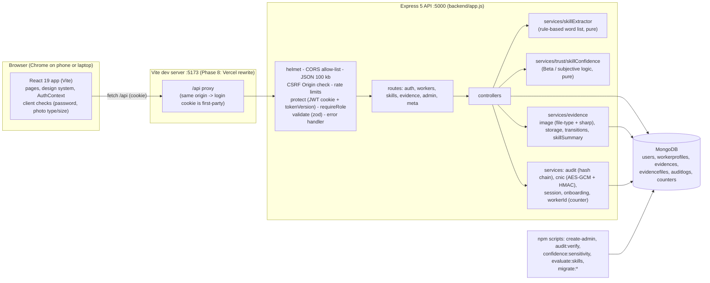
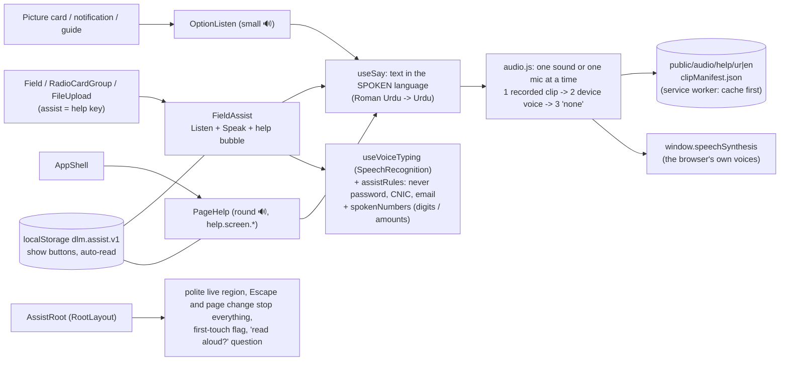
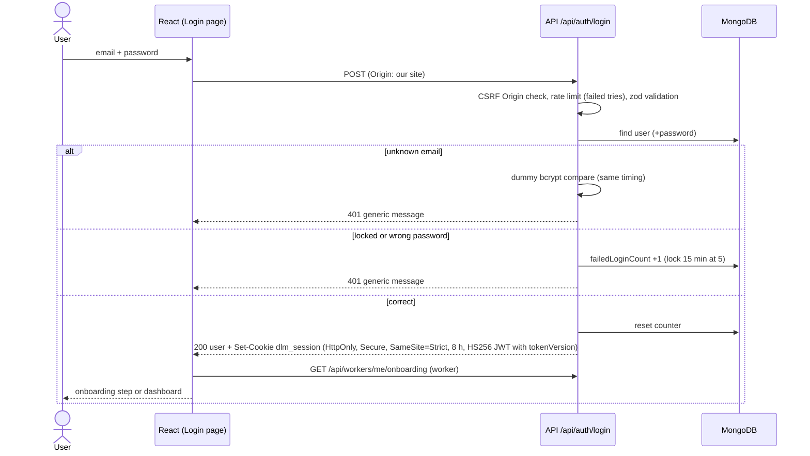

# Architecture (after Batch 2, 9 Nov 2026; Batch 5 section added 16 Nov 2026)

A MERN single-page application. Everything below exists in the code today; Vercel deployment is
Phase 8 (not done). No external AI service and no LLM is used anywhere.

## Components



Folders: `backend/config` (env check, DB connection, taxonomy, evidence limits), `models`, `routes`,
`controllers`, `services`, `validators`, `middleware`, `scripts`, `evaluation`, `tests`;
`frontend/src/components/ui` (design system), `features` (forms, skills editor, evidence),
`pages`, `routes` (guards), `hooks`, `utils`, `test`.

## Listen, Speak, See (Batch 5, frontend only; D-033 to D-036)



Folders: `frontend/src/features/assist` (audio service, voices, settings store, help row, page help,
Sound menu, read-aloud question, voice notice, clip keys), `utils/spokenNumbers.js` and
`utils/numberWords.js` (a copy of the extractor's number words, checked by a test),
`pages/public/VoiceCheck.jsx` (`/voice-check`), `pages/dev/ClipRecorder.jsx` (`/dev/recorder`,
development builds only), `scripts/audio-manifest.mjs`, `scripts/i18n-review-batch5.mjs`. No server
code, no new package, no outside service: speech is the browser's own Web Speech API.

## Module 4: bookings, reviews and reputation (Batch 6, D-037 to D-058)

- **Pure engines** (no database, no clock, no randomness): `services/reputation/{beta,reputationEngine,
  reliabilityEngine,snapshot,matchingSignals}.js` and `services/booking/{transitions,schedule,contactInfo}.js`.
  The live API, the sensitivity script and the simulation (`evaluation/reputation/`) import the same files.
- **Database steps:** `services/booking/lifecycle.js` (conditional step, booking codes, after-close: audit,
  recompute, pattern check), `services/booking/sweep.js` (every due timer), `services/booking/contact.js` (the
  only reader of phone numbers for bookings), `services/reputation/recompute.js` (the only writer of the
  snapshot), `services/reputation/patternCheck.js` (flags).
- **Routes:** `/api/bookings` (`routes/bookings.js`), `/api/reviews`, `/api/cron/daily`, new `/api/workers/...`
  and `/api/admin/...` routes (`docs/API.md`). Every booking read sweeps first.
- **Frontend:** `features/booking/` (cards, actions, timeline, contact card, Hear this request, reason dialogs),
  `features/reputation/` (the only folder that draws stars: rating line, panel, stars input, review list,
  verified history), pages under `pages/customer`, `pages/worker`, `pages/booking`, `pages/admin`.
- **Data flow:** booking outcome / review → recompute → `WorkerProfile.reputation` → public profile, directory
  card, "Best track record", `toMatchingSignals` for Module 7 (diagram in `docs/modules/MODULE-4.md` §3).

## Request flows

### Login (D-006)


### Guided onboarding (D-011)
```mermaid
sequenceDiagram
  actor W as Worker
  participant R as React (/onboarding/:step)
  participant A as API
  participant X as skillExtractor (pure)
  participant M as MongoDB
  R->>A: GET /api/workers/me/onboarding
  A->>M: load profile
  A-->>R: { steps, nextStep } (derived from saved data)
  W->>R: Step 1 About you -> Save
  R->>A: PUT /api/workers/me (CNIC encrypted + hashed on the server)
  A-->>R: { profile, onboarding.nextStep = "work" }
  W->>R: Step 2 Your work -> Save
  R->>A: PUT /api/workers/me
  A-->>R: nextStep = "skills" -> app opens Step 3 by itself
  W->>R: describe work
  R->>A: POST /api/workers/me/skills/extract
  A->>X: extractSkills(text)
  A-->>R: suggestions + matched words (nothing saved)
  W->>R: tick suggestions -> Add selected skills
  R->>A: POST /api/workers/me/skills
  A->>M: save skills; set onboardingCompletedAt
  R-->>W: Step 4 Proof (upload or skip) -> Step 5 All set
```

### Evidence upload and review (Module 3, D-013, D-015)
```mermaid
sequenceDiagram
  actor W as Worker
  actor AD as Admin
  participant R as React
  participant A as API
  participant I as services/evidence/image
  participant M as MongoDB
  W->>R: choose skill, kind, photo, tick consent
  R->>R: client check (magic bytes, 4 MB; shrink in browser if possible)
  R->>A: POST /api/evidence (multipart)
  A->>A: protect + role worker (before reading the file), upload rate limit
  A->>A: multer memory, 4 MB limit (413), zod fields (consent)
  A->>I: detect type from bytes (JPEG/PNG/WebP only)
  I->>I: sharp: autoOrient, fit 2000 px, WebP q80, no metadata
  I-->>A: processed bytes, SHA-256, dHash
  A->>M: same worker+skill+SHA-256? -> 409
  A->>M: other workers: same SHA-256 or dHash distance <= 10 -> possibleDuplicateOf
  A->>M: save EvidenceFile (bytes), Evidence (pending)
  A->>M: recompute skill evidenceSummary; audit "evidence.uploaded"
  A-->>R: 201 item "Pending review"
  AD->>R: Evidence review -> open item
  R->>A: GET /api/admin/evidence/:id (+ duplicate, b, d, u, E)
  AD->>R: Approve / Reject (reason) / Suspected fake (reason) / Revoke (reason)
  R->>A: PATCH /api/admin/evidence/:id
  A->>M: findOneAndUpdate where status = current (else 409)
  A->>M: recompute summary; audit "evidence.<new state>"
  A-->>R: new status + skill chip
```

## Where each security control sits

| Control | Where (code) | Proven by (tests) |
|---|---|---|
| Settings checked at start (secrets, origins, keys) | `config/env.js` | `foundation.test.js` |
| Security headers | `helmet()` in `app.js` | `foundation.test.js` |
| CORS allow-list | `cors({ origin: CLIENT_ORIGIN })` | `foundation.test.js` |
| CSRF Origin / Sec-Fetch-Site check | `middleware/csrf.js` | `auth.test.js` |
| Rate limits (failed auth; uploads) | `middleware/rateLimit.js` | `auth-rate-limit.test.js` |
| Login cookie, HS256 + iss/aud/exp, tokenVersion | `services/session.js`, `middleware/authMiddleware.js` | `auth.test.js` |
| Role checks on every protected route | `requireRole` in each `routes/*.js` | `admin.test.js`, `directory.test.js`, `evidence.test.js` |
| Input validation (body, query, params) | `validators/*.js` + `middleware/validate.js` | all integration tests |
| Operator-injection guard | `mongoose.set('sanitizeFilter', true)` in `config/db.js` | `directory.test.js` |
| Escaped regular expressions | `escapeRegex` in `validators/common.js` | `directory.test.js` |
| Public projections (no private fields) | `PUBLIC_WORKER_FIELDS` in `controllers/workersController.js` | `directory.test.js`, `evidence.test.js` |
| CNIC encryption + keyed hash, audited reveal | `services/cnic.js`, `controllers/adminController.js` | `cnic.test.js`, `workers-profile.test.js`, `admin.test.js` |
| Upload: size, real type, re-encode, metadata removal, owner-only serving | `middleware/upload.js`, `services/evidence/image.js`, `controllers/evidenceController.js` | `evidence.test.js` |
| Review state machine, atomic decisions | `services/evidence/transitions.js`, `controllers/adminEvidenceController.js` | `evidence.test.js` |
| Append-only, hash-chained audit log | `models/AuditLog.js`, `services/audit.js`, `npm run audit:verify` | `admin.test.js`, `evidence.test.js` |
| Generic 500 messages | `middleware/errorHandler.js` | `foundation.test.js` |
| UI route guards (convenience only) | `frontend/src/routes/guards.jsx` | `auth.test.jsx`, `pages.test.jsx` |
