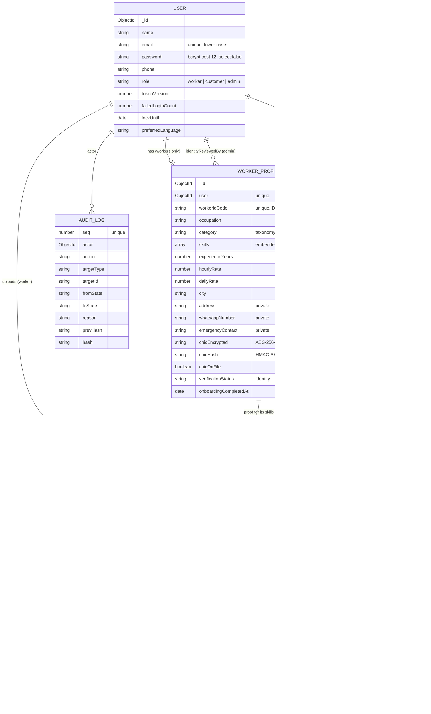

# Data model (MongoDB, after Batch 4, 11 Nov 2026)

Source of truth: `backend/models/*.js` (Mongoose 9). Field lists below were read from the schemas.
`*` = required. Collections are created by Mongoose with these names.

## ER diagram

## users
| Field | Type | Notes |
|---|---|---|
| name* | String | trim, ≤ 60 |
| email* | String | unique, lower-case, trim, ≤ 254 |
| password* | String | bcrypt hash (cost 12); `select: false` (never loaded unless asked) |
| phone* | String | `03XXXXXXXXX`; never public (D-002) |
| role | String | `worker` (default) \| `customer` \| `admin` (admins only via `npm run create-admin`) |
| tokenVersion | Number | in every login token; +1 at logout ends old sessions (D-006) |
| failedLoginCount, lockUntil | Number, Date | 5 wrong passwords → 15-minute lock |
| preferredLanguage | String or null | `en`, `ur` or `ur-Latn` (Batch 3, D-019); null until chosen; set at register or by `PATCH /api/users/me/preferences` |
| preferredTheme | String or null | `light`, `dark` or `system` (Batch 4, D-022); null until chosen |
| preferredTextSize | String or null | `small`, `normal` or `large` (Batch 4); null until chosen |
| status | String | `active` (default) \| `suspended` (Batch 4, D-024); a suspended user cannot log in |
| suspendedAt, suspendedBy, suspensionReason | Date, ObjectId → users, String ≤ 300 | set when an admin suspends; cleared on reactivation; the reason is also in the audit log |
| createdAt, updatedAt | Date | timestamps |

Indexes: `{ email: 1 }` unique.

## workerprofiles
| Field | Type | Notes |
|---|---|---|
| user* | ObjectId → users | unique (one profile per worker) |
| workerIdCode | String | unique; `DLM-<year>-<6 digits>` from `counters` (M1-8) |
| identityRequestedAt | Date or null | Batch 4: when the worker last saved a CNIC (asked for an identity check); the admin queue shows "waiting N days" from it |
| approvedEvidenceCount | Number | Batch 4: sum of approved proof items over all skills; the directory's "most approved proof" sort key; kept in step by a save hook and by `recomputeSkillSummary` |
| occupation | String | ≤ 60; empty = not filled in yet |
| category | String | taxonomy id or null (D-012) |
| skills | [Skill] | embedded, one entry per skill (below) |
| experienceYears | Number | whole, 0–60, null = not filled in |
| hourlyRate, dailyRate | Number | 0–1,000,000 (PKR) |
| city | String | ≤ 50 |
| address, whatsappNumber, emergencyContact | String | private: owner and admin only |
| cnicEncrypted | String | AES-256-GCM, owner id as additional data; `select: false` (D-007) |
| cnicHash | String | HMAC-SHA256 for duplicate detection; `select: false` |
| cnicOnFile | Boolean | the only CNIC fact sent to the owner and admins |
| cnicNumber | String | old plain text, only for `npm run migrate:cnic`; `select: false` |
| languages | [String] | each ≤ 30 |
| availability | String | `Available` \| `Busy` \| `Offline` |
| verificationStatus | String | identity: `Unverified` \| `Pending` \| `Verified` \| `Rejected` (D-009) |
| identityNote, identityReviewedBy, identityReviewedAt | String, ObjectId, Date | last identity decision |
| bio | String | ≤ 500 |
| workHistory | [{ jobTitle*, clientOrEmployer, duration, description }] | client name never public |
| profileCompletion | Number | documented checklist (`services/profileCompletion.js`) |
| onboardingCompletedAt | Date | first time about + work + skills were all done (D-011) |
| rawExperienceText, lastExtractedAt | String (select:false), Date | text used when skills were added from suggestions |
| createdAt, updatedAt | Date | timestamps |

**Skill (embedded):** `skillId*` (taxonomy id or `custom-<slug>`), `name*`, `category*`,
`addedVia*` (`extractor` \| `manual`), `custom`, `addedAt`, `evidenceSummary` =
`{ status (self_declared | evidence_pending | verified | disputed), approved, pending, strength (none | weak | moderate | strong), updatedAt }`.
Unique per `skillId` (schema validator). `evidenceSummary` is recomputed after every evidence change;
it holds no numbers (b, d, u, E are computed on demand for admins).

Indexes: `{ user: 1 }` unique; `{ workerIdCode: 1 }` unique; `{ cnicHash: 1 }` unique where `cnicHash` is a string.

## evidences (Module 3, D-013)
| Field | Type | Notes |
|---|---|---|
| worker* | ObjectId → users | owner |
| profile* | ObjectId → workerprofiles | for the admin queue (worker ID) |
| skillId*, skillName* | String | the one skill this proves (must be on the profile) |
| type* | String | `certificate` \| `work_photo` \| `reference_letter` |
| title | String | optional, ≤ 80 |
| status* | String | `pending` → `approved` \| `rejected` \| `suspected_fake`; `approved` → `revoked` \| `suspected_fake` (D-015) |
| reasonCode | String | for `rejected`: `unclear` \| `not_relevant` \| `wrong_skill` \| `other` |
| reviewNote | String | shown to the worker; required words for suspected fake and revoke |
| reviewedBy, reviewedAt | ObjectId, Date | last decision |
| consentAt* | Date | when the worker ticked the consent box |
| fileId* | ObjectId → evidencefiles | the bytes |
| contentType*, size*, width*, height* | | processed WebP facts |
| sha256* | String | SHA-256 of the processed file (exact duplicates) |
| dhash* | String | 64-bit perceptual hash, 16 hex characters (look-alikes) |
| possibleDuplicateOf, duplicateKind, duplicateDistance | ObjectId, `exact`\|`similar`, Number | another worker's item; admin-only |
| createdAt, updatedAt | Date | timestamps |

Indexes: `{ worker: 1, skillId: 1, sha256: 1 }` unique (same photo twice for one skill → 409, also
under a race; its prefix serves "this worker's skill" queries); `{ status: 1, createdAt: 1 }` (review
queue, oldest first); `{ sha256: 1 }` (exact duplicates from other workers); `{ possibleDuplicateOf: 1 }`
partial (duplicate filter).

## evidencefiles (Module 3, D-013)
| Field | Type | Notes |
|---|---|---|
| data* | Buffer (BinData) | the processed WebP (the original is never stored) |
| contentType* | String | `image/webp` |
| size* | Number | bytes |
| createdAt | Date | |
Reached only through `services/evidence/storage.js` (`save`, `read`, `remove`); list queries never load it.

## auditlogs (append-only)
| Field | Type | Notes |
|---|---|---|
| seq* | Number | unique, 1, 2, 3 … (one chain) |
| actor, actorRole | ObjectId → users, String | `system` for scripts |
| action* | String | `admin.created`, `cnic.updated`, `cnic.reveal`, `identity.decision`, `evidence.uploaded`, `evidence.approved`, `evidence.rejected`, `evidence.suspected_fake`, `evidence.revoked`, `evidence.deleted`; Batch 4: `user.suspended`, `user.reactivated`, `export.downloaded`, `template.created`, `template.updated`, `template.deleted`, `template.starter_set` |
| targetType, targetId | String | e.g. `Evidence`, its id |
| fromState, toState, reason, details | | never a CNIC number |
| createdAt* | Date | |
| prevHash*, hash* | String | hash = SHA-256(prevHash + canonical JSON of the entry); checked by `npm run audit:verify` |
Update and delete operations are refused by schema hooks. Indexes: `{ seq: 1 }` unique; `{ targetType: 1, targetId: 1, seq: 1 }`.

## notifications (Batch 4, D-025)
| Field | Type | Notes |
|---|---|---|
| user* | ObjectId → users | the only person who can read or mark it |
| type* | String | `identity_verified`, `identity_rejected`, `evidence_approved`, `evidence_rejected`, `evidence_suspected_fake`, `evidence_revoked` |
| params | Object | only `skillId`, `skillName`, `evidenceId`, `reasonCode`, `note` (≤ 500 characters each); never a CNIC |
| readAt | Date or null | null = unread |
| createdAt | Date | a TTL index removes notifications after 180 days |
Indexes: `{ user: 1, createdAt: -1 }`, `{ user: 1, readAt: 1 }`, `{ createdAt: 1 }` TTL. The text is not stored: the website builds it from `type` and `params` in the user's language.

## savedworkers (Batch 4)
| Field | Type | Notes |
|---|---|---|
| customer* | ObjectId → users | the customer who saved |
| profile* | ObjectId → workerprofiles | the saved worker |
| createdAt | Date | |
Indexes: `{ customer: 1, profile: 1 }` unique (saving twice keeps one row), `{ customer: 1, createdAt: -1 }`. At most 100 per customer.

## reasontemplates (Batch 4)
| Field | Type | Notes |
|---|---|---|
| kind* | String | `identity_verify`, `identity_reject`, `evidence_reject`, `evidence_fake`, `evidence_revoke`, `user_suspend`, `user_reactivate` |
| text.en* | String | 5–300 characters |
| text.ur, text.ur-Latn | String | optional, ≤ 300 |
| createdBy, updatedBy | ObjectId → users | the admin |
| createdAt, updatedAt | Date | timestamps |
At most 60 templates. Texts are checked for CNIC-like numbers before they are saved.

## counters
`{ _id: "workerId-<year>", seq }`, increased with an atomic `$inc` (year = Pakistan time).
