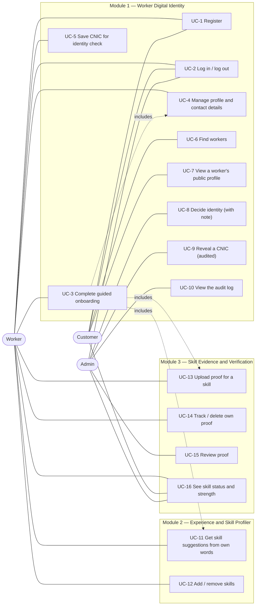

# Use cases (Modules 1–3, after Batch 2)

Actors: **Worker** (daily-wage or skilled worker), **Customer** (household or small business),
**Admin** (platform team; created only by `npm run create-admin`). "System" = the API.

| ID | Use case | Actor | Main flow | Alternative / error flows |
|---|---|---|---|---|
| UC-1 | Register | Worker, Customer | Choose role card (find work / hire) → name, email, mobile, 15+ character password → account + login cookie → worker goes to onboarding Step 1, customer to Find workers | Email already used → 409 shown at the email field; short password → stopped in the browser and by the server; `role: admin` → 400 (no admin option exists) |
| UC-2 | Log in / log out | All | Email + password → cookie → home of the role (worker: onboarding step or dashboard). Log out ends every session of that user | Wrong email or password → one generic message; 5 failures → 15-minute lock; too many failures from one network → 429; expired session → Login with "Your session has ended" |
| UC-3 | Guided onboarding | Worker | Step 1 About you → Step 2 Your work → Step 3 Your skills (opens by itself) → Step 4 Proof of skills (upload or skip) → Step 5 All set → dashboard. Progress comes from the server | Later steps cannot be skipped (sent back to the missing step); Back keeps typed data; closing the browser loses nothing already saved |
| UC-4 | Manage profile | Worker | Edit personal/contact details (phone, WhatsApp, area, emergency contact, languages) and work details (trade, experience, rates, availability, bio, past jobs) | Invalid values (negative rate, unknown trade) → messages next to the fields |
| UC-5 | Save CNIC | Worker | Type `#####-#######-#` → stored encrypted; identity becomes "Pending review" | CNIC used by another account → 409; the CNIC is never shown back, only "Saved (hidden)" |
| UC-6 | Find workers | Customer | Search text + filters (trade, city, availability, identity verified, verified skills) → cards with trade, city, experience, rates, identity and skill chips → pagination | No results → empty state with "Clear filters"; server error → message + Try again. No phone, email, address, CNIC or photos ever |
| UC-7 | View public profile | Customer | Open a card → public details, skills with chip, "Evidence: N approved" and strength; note "contact after an accepted booking" | Unknown worker ID → "Worker not found" |
| UC-8 | Decide identity | Admin | Identity review → open worker → choose Verified/Rejected → write note → save (audited) | No CNIC saved → Verified not possible; another admin changed it → 409 "reload" |
| UC-9 | Reveal CNIC | Admin | Reveal → confirmation "This will be recorded in the audit log" → number shown | Cancel → nothing revealed or logged |
| UC-10 | View audit log | Admin | Audit log → filter by action and dates → read-only list | `npm run audit:verify` checks the hash chain |
| UC-11 | Skill suggestions | Worker | Write or say (optional voice, with notice) what you do → "Find my skills" → suggestions grouped by trade with matched words, experience found → nothing saved | No trade words → explanation + manual list; tie between trades → shown, not decided |
| UC-12 | Add / remove skills | Worker | Tick suggestions → "Add selected skills", or pick from the list; remove with confirmation; "Use these on my profile" copies trade/years only on click | Skill with reviewed proof cannot be removed (409) |
| UC-13 | Upload proof | Worker | Choose skill and kind (certificate / work photo / reference letter) → photo (camera or gallery) → consent → upload with progress → "Pending review" | Wrong type, HEIC, PDF or > 4 MB → message before upload and from the server; same photo again for the skill → 409; no consent → stopped |
| UC-14 | Track / delete proof | Worker | Dashboard or Your skills → each skill's chip, approved count, strength, items with status and reason → delete pending or rejected items | Approved, revoked or suspected-fake items cannot be deleted |
| UC-15 | Review proof | Admin | Evidence review → queue (oldest first, filters) → drawer with zoomable photo, possible duplicate side by side, b/d/u/E → Approve, Reject (reason), Suspected fake (reason) or Revoke (reason) → audited | Missing reason → stopped; invalid transition → 400; two admins at once → one gets 409 |
| UC-16 | See skill status | All | Chips: Self-declared, Evidence pending, Verified by evidence, Disputed; strength None/Weak/Moderate/Strong (no percentages) | "Disputed" always wins over "Verified by evidence" |
