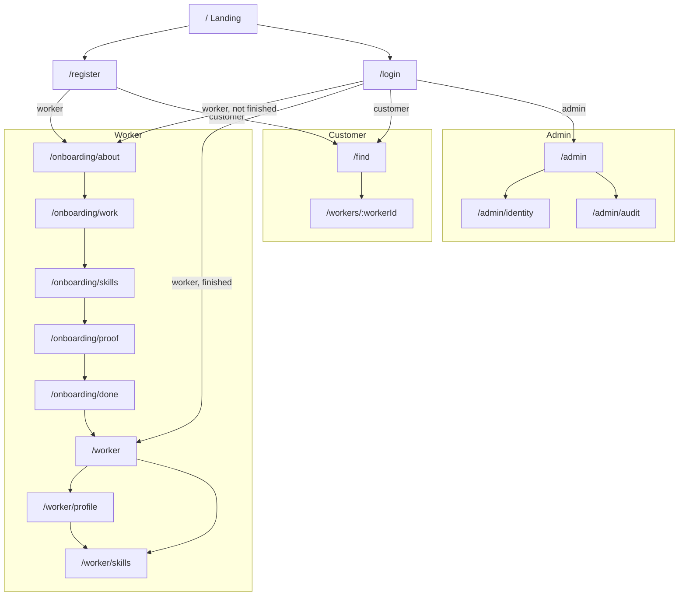
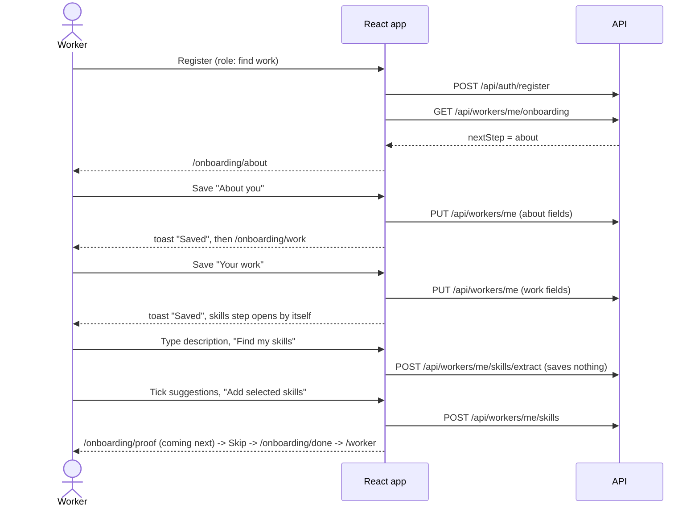
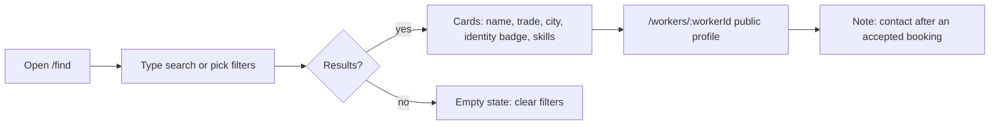
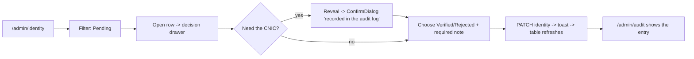

# 02 — UX analysis (Batch 1, 9 Nov 2026)

## Audit of the UI before Batch 1

| Screen | What is wrong | Why it matters |
|---|---|---|
| All | Default-template look (indigo `#4f46e5`, "DL" box logo, Plus Jakarta Sans from Google Fonts); about 136 inline `style={{…}}` blocks; no shared components | Looks unfinished; every page differs; Google font request on slow data and a privacy leak |
| Navigation | Worker menu shows "My Profile" and "AI Skill Profiler" side by side | Worker must discover Module 2 alone; "AI" label is not honest (M2-15) |
| `/` | Shows the Register form | No explanation of the product for either side |
| Register | Role toggle looks like tabs; password rule only as small text; server errors shown as one banner | Role choice is the most important decision; errors are not next to the field |
| Worker profile | One very long form, everything on one screen | Hard on a 360 px phone; no sense of progress |
| Skill profiler | Shows invented percentages and levels, saves on analysis, "Clear profile" wipes Module 1 data | Audit M2-2, M2-3, M2-8, M2-9 |
| Customer | Long cards with many inline styles, filters in one row that overflows at 360 px | Horizontal scroll on phones |
| Admin | One table, form squeezed into a table cell, `window.confirm` for CNIC reveal | Not usable on small screens; browser confirm is not styled or accessible |
| Errors | No error boundary; 404 page only | A crash shows a blank page |

## Information architecture (sitemap)

## User flows

### Worker: first visit to dashboard

### Customer: find a worker

### Admin: identity decision

