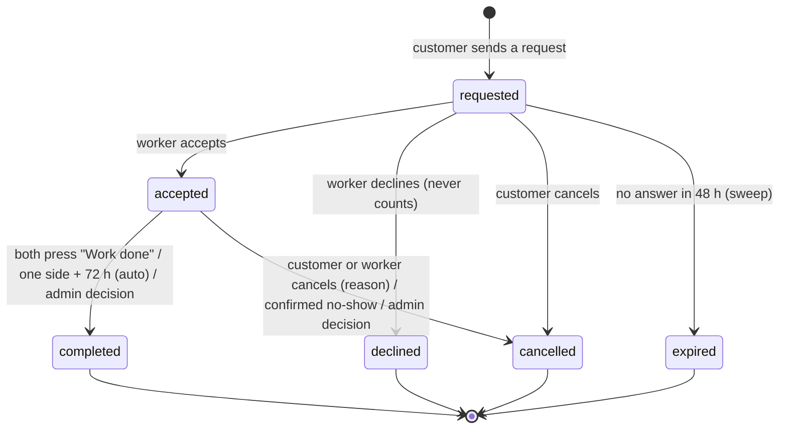
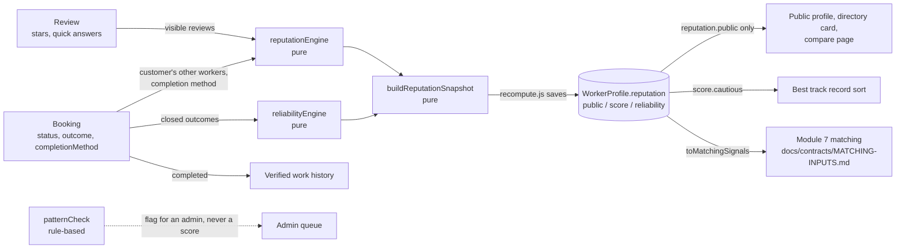

# Module 4 — Reputation and Reliability Engine (Batch 6, 16–17 Nov 2026; rep-2 in Batch 6B, 17 Nov 2026)

Bookings that create real work records, reviews after completed work, a weighted reputation score that
says how sure it is, a reliability record, and an evaluation by simulation. Nothing in this module is
"AI": every number comes from written formulas (a weighted Beta reputation model) and fixed rules.

The team reports that the supervisor approved (1) keeping a minimal Work Booking inside Module 4 and
(2) evaluating the reputation engine by simulation (16 Nov 2026; decisions D-037 and D-038).

## 1. What the module does (proposal bullets)

| Proposal bullet | How it is met |
|---|---|
| Collection of customer ratings and reviews after completed work | A review is possible only for a `completed` booking, only by its customer, once, within 14 days, not while a dispute is open; never editable (D-041). |
| Calculation of worker reputation based on work-related records | `services/reputation/reputationEngine.js`: each review is weighed by how the job was confirmed and repeats by the same customer; reviews from first-time customer accounts count together at most B reviews' worth; many reviews in a few days count less; the prior is the platform's typical rating (rep-2, live since Batch 6B, D-061 to D-066; rep-1 of Batch 6: D-043, D-044). |
| Maintenance of reliability indicators such as completed jobs and cancellations | `services/reputation/reliabilityEngine.js` from booking outcomes (completed, early and late worker cancellations, no-shows); declining never counts (D-040, D-046). |
| Display of relevant reputation information on worker profiles | Public profile: stars with the count, depth in words, star bars, quick-answer counts, reliability counts, reviews with replies, verified work history; directory card line (D-047). |
| Use of verified work history as supporting information for future matching | `toMatchingSignals(snapshot)` and `docs/contracts/MATCHING-INPUTS.md` for Module 7; "Best track record" sort (D-045). |

## 2. The booking state machine

Every arrow is a conditional update on the state that was checked: a double tap or two people at the same
moment get 409 `BOOKING_CHANGED`; a step the state does not allow gets 400 `BOOKING_NOT_ALLOWED`. Every step
is pushed onto `statusHistory`. The small dispute step (completion contested, no-show contested,
cancellation fault) holds the booking until an admin decides; only one dispute per booking (D-049).

**Outcome** (the one field reliability reads): `completed` (+1), `cancelled_by_worker_early` (−0.5, 24 hours or
more before the start), `cancelled_by_worker_late` (−1), `worker_no_show` (−1); `cancelled_by_customer`,
`declined`, `expired`, `closed_no_fault` count nothing.

## 3. Data flow

`recompute.js` is the only reputation code that touches the database. It runs after a booking is completed
or closed with an outcome; after a review is created, hidden or restored; after a dispute decision; and once
a day from the cron for every worker with a booking. It does not change `updatedAt`, so "Recently updated"
is not affected. A worker without a snapshot is "new on this platform" (no migration needed).

## 4. The formulas (config: `backend/config/reputationParams.js`, all provisional)

**Stars to evidence** (graded feedback, Jøsang & Ismail 2002, §2.7): `p = (stars − 1) / 4`; a review adds
`w·p` to the positive evidence `r` and `w·(1 − p)` to the negative evidence `s`.

**Weight** `w = provenance × recency × reviewerTrust × pairFactor`:

| Factor | Rule | Why |
|---|---|---|
| provenance | both or admin 1.0; auto 0.6 | a job both people confirmed is stronger proof |
| recency | `0.5 ^ (ageDays / 365)` | the paper's forgetting factor (§2.6): people improve or get worse |
| reviewerTrust | `0.5 + 0.5 · min(n, 3) / 3`, n = other workers this customer finished a job with | the paper discounts feedback by its provider's standing (§2.5); a fake account must first book and finish real jobs |
| pairFactor | the k-th review from the same customer counts `1/k` | ten reviews from one friend are not ten opinions |

`reviewerTrust` uses the customer's history **now**: an old review counts more once its author has hired other
workers. This is intended.

**Beta numbers** (W = 2, a = 0.5): `belief = r/(r+s+W)`, `disbelief = s/(r+s+W)`, `uncertainty = W/(r+s+W)`,
`expected = belief + a·uncertainty = (r+1)/(r+s+2)`. **Cautious** `= max(0, expected − 1.2816·sd)` with `sd` the
standard deviation of Beta(r + W·a, s + W·(1 − a)): a normal approximation of the lower 10% point ("about 90%
sure the true value is at least this"). **Depth**: none (no visible reviews), few (u > 0.4), some, many (u ≤ 0.2).

**Worked examples** (each is a unit test in `backend/tests/unit/reputationEngine.test.js`, four decimals, all passing):

| Case | r | s | uncertainty | expected | cautious |
|---|---|---|---|---|---|
| No reviews | 0 | 0 | 1.0000 | 0.5000 | 0.1300 |
| One 5★, weight 1 | 1 | 0 | 0.6667 | 0.6667 | 0.3646 |
| One 1★, weight 1 | 0 | 1 | 0.6667 | 0.3333 | 0.0313 |
| One 4★, weight 1 | 0.75 | 0.25 | 0.6667 | 0.5833 | 0.2674 |
| One 3★, weight 1 | 0.5 | 0.5 | 0.6667 | 0.5000 | 0.1796 |
| One 5★, weight 0.5 (new reviewer, or one year old) | 0.5 | 0 | 0.8000 | 0.6000 | 0.2644 |
| One 5★, auto-completed (0.6) | 0.6 | 0 | 0.7692 | 0.6154 | 0.2868 |
| Ten 5★, each weight 1 | 10 | 0 | 0.1667 | 0.9167 | 0.8184 |
| Three 5★ from the same customer (1, 1/2, 1/3) | 1.8333 | 0 | 0.5217 | 0.7391 | 0.4832 |
| 28 × 5★ + 12 × 4★ (average 4.7, 40 reviews) | 37 | 3 | 0.0476 | 0.9048 | 0.8474 |

By `cautious`, 40 reviews averaging 4.7 rank above 10 perfect reviews, and both far above one perfect review;
a plain average puts the single 5★ first. `npm run reputation:sensitivity` shows that this order holds for
every tested half-life, auto weight and trust floor, and for W = 2 and 4, but **not for W = 1** (ten 5★ then
score 0.8775 against 0.8594).

**Reliability** (same Beta numbers, same recency weight; tests in `reliabilityEngine.test.js`): nothing →
0.5000 / 1.0000; 10 completed → 0.9167 / 0.1667; + 1 late cancellation → 0.8462 / 0.1538; + 1 early
cancellation instead → 0.8800 / 0.1600; 3 completed + 1 no-show → 0.6667 / 0.3333 (expected / uncertainty).

### 4.1 rep-2 (live since Batch 6B, 17 Nov 2026; D-061 to D-066)

The Batch 6 simulation (§5.1–5.3) showed that rep-1's settings are not better than a plain average. rep-2 makes
five changes that follow from that analysis; everything else (stars to evidence, the Beta numbers, provenance, the
pair factor, depth thresholds, reliability) is unchanged. rep-1 stays in `config/reputationParams.js`
(`REP1_PARAMS`, hash `23974876a27d`) as a method of the evaluation.

| Change | rep-1 | rep-2 | Why (Batch 6 finding, SIMULATION) |
|---|---|---|---|
| 1. Recency | `0.5 ^ (age / 365)` | off (`halfLifeDays: null`, weight 1); the code stays for a pilot | fake reviews are always new; recency off lowered the attack lift in 7 of 8 attack scenarios |
| 2. New reviewers | trust floor 0.5 + ramp to 1 after 3 other workers | reviewers with no completed job with any other worker count fully, but **together at most B reviews' worth**: each is multiplied by `min(1, B / m)`, m = the sum of their weights; reviewers with a hiring history count 1 | the floor halved every genuine first-time customer but still let ten fakes add five reviews' worth |
| 3. Burst check | – | a review with 3 or more other reviews of the worker in the 14 days before it (the same moment counts) counts half | a candidate; the pre-registered selection decides |
| 4. Prior | a = 0.5 (3 stars) | a = the plain mean of `(stars − 1) / 4` over all visible reviews on the platform, clamped to [0.2, 0.9]; 0.5 below 20 reviews. `recompute.js` passes it in; the snapshot stores `baseRate` | 0.5 is far below typical ratings, so workers with few reviews were pushed down whatever their stars |
| 5. Ranking number | `cautious` | `expected` (`cautious` and `uncertainty` stay in the snapshot and in `toMatchingSignals`) | B4 (expected, unweighted) had the best NDCG@10 in the base world |

**Chosen by the pre-registered selection (§5.4): B = 1, burst check on.** `expected = (r + W·a) / (r + s + W)`, W = 2;
cautious as before with Beta(r + W·a, s + W·(1 − a)).

Hand-worked rep-2 examples (each is a unit test in `backend/tests/unit/reputationEngineRep2.test.js` with explicit
parameters B = 2, burst off, four decimals, all passing):

| Case (a = 0.8 unless said) | r | s | uncertainty | expected | cautious |
|---|---|---|---|---|---|
| No reviews | 0 | 0 | 1.0000 | 0.8000 | 0.5040 |
| One 5★ | 1 | 0 | 0.6667 | 0.8667 | 0.6488 |
| One 1★ | 0 | 1 | 0.6667 | 0.5333 | 0.2136 |
| Ten 5★, reviewers with history | 10 | 0 | 0.1667 | 0.9667 | 0.9029 |
| 28 × 5★ + 12 × 4★, reviewers with history | 37 | 3 | 0.0476 | 0.9190 | 0.8657 |
| Three 5★ from the same customer (1, 1/2, 1/3) | 1.8333 | 0 | 0.5217 | 0.8957 | 0.7174 |
| Ten 5★ from ten new reviewers, B = 2 (0.2 each) | 2 | 0 | 0.5000 | 0.9000 | 0.7281 |
| Two 4★ (history) + five 5★ from new reviewers, B = 2 (0.4 each) | 3.5 | 0.5 | 0.3333 | 0.8500 | 0.6770 |
| The same seven reviews with no budget | 6.5 | 0.5 | 0.2222 | 0.9000 | 0.7784 |
| Two 5★ from two new reviewers, B = 2 (the budget does not bite) | 2 | 0 | 0.5000 | 0.9000 | 0.7281 |
| Platform with fewer than 20 reviews: a = 0.5, one 5★ | 1 | 0 | 0.6667 | 0.6667 | 0.3646 |

**An honest change of the viva example:** by `expected`, ten 5★ reviews from customers with a hiring history
(0.9667) now rank **above** forty reviews averaging 4.7 (0.9190); rep-1's `cautious` put the forty first. Both stay
far above a single 5★ (0.8667). `npm run reputation:sensitivity` prints rep-2's tables for B 1/2/3, burst off/on,
a 0.5/0.7/0.8 and W 1/2/4.

**Public depth word (D-066):** with B = 1, twelve reviews from twelve first-time customers are one review's worth of
evidence; "Few reviews yet" next to "(12)" would contradict what customers see. For rep-2 snapshots the public word
follows the number of visible reviews (the same thresholds as if each weighed 1); the score's own `depth`
(the worker, admins, matching) stays evidence-based.

## 5. Evaluation by simulation

How: `backend/evaluation/reputation/` (README there lists every assumption). 300 workers per run, hidden quality
q ~ Beta(4, 2), 30% of workers without reviews, the rest a mean of 4 reviews, stars from q with Normal(0, 0.15)
noise; 11 scenarios (base, inflation, naive and "smart" Sybil attacks with 3, 5 and 10 fake reviews, pair
collusion, quality change, combined); baselines B1 plain average, B2 Bayesian average, B3 Wilson lower bound,
B4 plain Beta; ours = the production engine's cautious score; ablations; Kendall's tau-b, NDCG@10/20,
Precision@10, attack lift (places bought by the fake reviews), new-worker position; paired comparison seed by
seed. Run: `npm run evaluate:reputation -- --scenario all --seeds 30` and `node evaluation/reputation/explore.js --seeds 30`.

> **These are SIMULATION results.** They show how the methods behave if the simulator's assumptions hold. They
> are not real-world results, and they do not show that the assumptions are true. Quote them only with the word
> "simulation", the scenario and the number of seeds. The tables below are generated from the committed files
> by `node docs/tools/simulation-tables.mjs`.

### 5.1 Results (SIMULATION)

SIMULATION results: 30 seeds (20261116..20261145), 300 workers per run, engine rep-1, parameters 23974876a27d, git cb05f38, run on 2026-11-16. Mean (standard deviation) over seeds.

| Scenario | Method | Kendall tau-b (>= 1 review) | NDCG@10 (all) | Precision@10 (all) | Attack lift (places) | New-worker percentile |
|---|---|---|---|---|---|---|
| base | B1 plain average | 0.678 (0.028) | 0.893 (0.036) | 0.673 (0.160) | – | 14.777 (1.308) |
| base | B2 Bayesian average (m = 5) | 0.649 (0.027) | 0.937 (0.017) | 0.877 (0.107) | – | 46.951 (1.839) |
| base | B3 Wilson lower bound (4-5 stars) | 0.549 (0.032) | 0.895 (0.022) | 0.663 (0.138) | – | 23.715 (1.699) |
| base | B4 plain Beta (all weights 1) | 0.633 (0.032) | 0.938 (0.017) | 0.880 (0.110) | – | 30.404 (1.888) |
| base | Ours: weighted Beta, cautious | 0.441 (0.045) | 0.903 (0.022) | 0.677 (0.143) | – | 19.805 (1.924) |
| base | Ablation: expected instead of cautious | 0.562 (0.038) | 0.919 (0.019) | 0.767 (0.109) | – | 30.869 (2.026) |
| inflation | B1 plain average | 0.655 (0.029) | 0.860 (0.029) | 0.557 (0.170) | – | 14.777 (1.308) |
| inflation | B2 Bayesian average (m = 5) | 0.633 (0.027) | 0.915 (0.016) | 0.753 (0.150) | – | 48.122 (1.923) |
| inflation | B3 Wilson lower bound (4-5 stars) | 0.402 (0.047) | 0.838 (0.032) | 0.417 (0.129) | – | 18.344 (1.515) |
| inflation | B4 plain Beta (all weights 1) | 0.540 (0.039) | 0.909 (0.019) | 0.717 (0.162) | – | 20.639 (1.773) |
| inflation | Ours: weighted Beta, cautious | 0.333 (0.048) | 0.875 (0.024) | 0.547 (0.155) | – | 16.081 (1.585) |
| inflation | Ablation: expected instead of cautious | 0.440 (0.047) | 0.888 (0.024) | 0.600 (0.144) | – | 21.038 (1.913) |
| sybil_k3 | B1 plain average | 0.496 (0.038) | 0.789 (0.056) | 0.450 (0.153) | 112.112 (14.676) | 13.317 (1.266) |
| sybil_k3 | B2 Bayesian average (m = 5) | 0.464 (0.034) | 0.869 (0.061) | 0.657 (0.176) | 126.199 (11.677) | 44.064 (1.840) |
| sybil_k3 | B3 Wilson lower bound (4-5 stars) | 0.411 (0.037) | 0.889 (0.025) | 0.643 (0.148) | 111.269 (12.146) | 20.493 (1.529) |
| sybil_k3 | B4 plain Beta (all weights 1) | 0.422 (0.037) | 0.872 (0.062) | 0.673 (0.176) | 139.456 (11.639) | 26.041 (1.853) |
| sybil_k3 | Ours: weighted Beta, cautious | 0.240 (0.043) | 0.882 (0.034) | 0.610 (0.160) | 141.726 (13.349) | 17.330 (1.827) |
| sybil_k3 | Ablation: expected instead of cautious | 0.336 (0.036) | 0.879 (0.049) | 0.643 (0.181) | 152.027 (12.747) | 26.342 (1.866) |
| sybil_k5 | B1 plain average | 0.466 (0.036) | 0.789 (0.056) | 0.450 (0.153) | 124.137 (13.466) | 13.317 (1.266) |
| sybil_k5 | B2 Bayesian average (m = 5) | 0.424 (0.034) | 0.684 (0.079) | 0.217 (0.144) | 148.350 (10.725) | 44.610 (1.699) |
| sybil_k5 | B3 Wilson lower bound (4-5 stars) | 0.354 (0.035) | 0.868 (0.040) | 0.590 (0.156) | 133.816 (12.097) | 20.493 (1.529) |
| sybil_k5 | B4 plain Beta (all weights 1) | 0.377 (0.035) | 0.675 (0.084) | 0.210 (0.142) | 157.926 (11.914) | 25.875 (1.844) |
| sybil_k5 | Ours: weighted Beta, cautious | 0.205 (0.039) | 0.744 (0.069) | 0.280 (0.147) | 155.271 (13.976) | 17.330 (1.827) |
| sybil_k5 | Ablation: expected instead of cautious | 0.298 (0.034) | 0.683 (0.070) | 0.183 (0.132) | 167.327 (14.460) | 26.252 (1.866) |
| sybil_k10 | B1 plain average | 0.431 (0.034) | 0.789 (0.056) | 0.450 (0.153) | 137.657 (12.876) | 13.317 (1.266) |
| sybil_k10 | B2 Bayesian average (m = 5) | 0.380 (0.028) | 0.563 (0.045) | 0.010 (0.031) | 169.437 (10.637) | 51.878 (6.716) |
| sybil_k10 | B3 Wilson lower bound (4-5 stars) | 0.293 (0.033) | 0.691 (0.069) | 0.193 (0.134) | 157.360 (11.777) | 20.493 (1.529) |
| sybil_k10 | B4 plain Beta (all weights 1) | 0.341 (0.032) | 0.563 (0.045) | 0.010 (0.031) | 172.398 (13.292) | 25.816 (1.812) |
| sybil_k10 | Ours: weighted Beta, cautious | 0.188 (0.038) | 0.576 (0.051) | 0.013 (0.035) | 161.499 (14.388) | 17.330 (1.827) |
| sybil_k10 | Ablation: expected instead of cautious | 0.276 (0.033) | 0.564 (0.046) | 0.007 (0.025) | 175.711 (15.550) | 26.219 (1.849) |
| smart_sybil_k3 | B1 plain average | 0.496 (0.038) | 0.789 (0.056) | 0.450 (0.153) | 112.112 (14.676) | 13.317 (1.266) |
| smart_sybil_k3 | B2 Bayesian average (m = 5) | 0.464 (0.034) | 0.869 (0.061) | 0.657 (0.176) | 126.199 (11.677) | 44.064 (1.840) |
| smart_sybil_k3 | B3 Wilson lower bound (4-5 stars) | 0.411 (0.037) | 0.889 (0.025) | 0.643 (0.148) | 111.269 (12.146) | 20.493 (1.529) |
| smart_sybil_k3 | B4 plain Beta (all weights 1) | 0.422 (0.037) | 0.872 (0.062) | 0.673 (0.176) | 139.456 (11.639) | 26.041 (1.853) |
| smart_sybil_k3 | Ours: weighted Beta, cautious | 0.205 (0.039) | 0.718 (0.073) | 0.260 (0.140) | 155.084 (13.881) | 17.330 (1.827) |
| smart_sybil_k3 | Ablation: expected instead of cautious | 0.298 (0.034) | 0.666 (0.067) | 0.190 (0.116) | 167.078 (14.380) | 26.264 (1.875) |
| smart_sybil_k5 | B1 plain average | 0.466 (0.036) | 0.789 (0.056) | 0.450 (0.153) | 124.137 (13.466) | 13.317 (1.266) |
| smart_sybil_k5 | B2 Bayesian average (m = 5) | 0.424 (0.034) | 0.684 (0.079) | 0.217 (0.144) | 148.350 (10.725) | 44.610 (1.699) |
| smart_sybil_k5 | B3 Wilson lower bound (4-5 stars) | 0.354 (0.035) | 0.868 (0.040) | 0.590 (0.156) | 133.816 (12.097) | 20.493 (1.529) |
| smart_sybil_k5 | B4 plain Beta (all weights 1) | 0.377 (0.035) | 0.675 (0.084) | 0.210 (0.142) | 157.926 (11.914) | 25.875 (1.844) |
| smart_sybil_k5 | Ours: weighted Beta, cautious | 0.190 (0.038) | 0.598 (0.044) | 0.033 (0.055) | 160.778 (14.377) | 17.330 (1.827) |
| smart_sybil_k5 | Ablation: expected instead of cautious | 0.280 (0.033) | 0.579 (0.043) | 0.020 (0.048) | 174.526 (15.397) | 26.219 (1.849) |
| smart_sybil_k10 | B1 plain average | 0.431 (0.034) | 0.789 (0.056) | 0.450 (0.153) | 137.657 (12.876) | 13.317 (1.266) |
| smart_sybil_k10 | B2 Bayesian average (m = 5) | 0.380 (0.028) | 0.563 (0.045) | 0.010 (0.031) | 169.437 (10.637) | 51.878 (6.716) |
| smart_sybil_k10 | B3 Wilson lower bound (4-5 stars) | 0.293 (0.033) | 0.691 (0.069) | 0.193 (0.134) | 157.360 (11.777) | 20.493 (1.529) |
| smart_sybil_k10 | B4 plain Beta (all weights 1) | 0.341 (0.032) | 0.563 (0.045) | 0.010 (0.031) | 172.398 (13.292) | 25.816 (1.812) |
| smart_sybil_k10 | Ours: weighted Beta, cautious | 0.185 (0.038) | 0.560 (0.037) | 0.000 (0.000) | 162.149 (14.549) | 17.330 (1.827) |
| smart_sybil_k10 | Ablation: expected instead of cautious | 0.273 (0.033) | 0.557 (0.037) | 0.000 (0.000) | 177.121 (16.027) | 26.219 (1.849) |
| pair_collusion | B1 plain average | 0.621 (0.027) | 0.849 (0.053) | 0.573 (0.180) | 107.316 (23.110) | 14.025 (1.288) |
| pair_collusion | B2 Bayesian average (m = 5) | 0.590 (0.029) | 0.870 (0.054) | 0.647 (0.178) | 109.331 (16.174) | 46.957 (1.932) |
| pair_collusion | B3 Wilson lower bound (4-5 stars) | 0.508 (0.031) | 0.891 (0.025) | 0.657 (0.130) | 108.042 (20.086) | 22.580 (1.664) |
| pair_collusion | B4 plain Beta (all weights 1) | 0.570 (0.031) | 0.868 (0.054) | 0.640 (0.177) | 121.544 (19.109) | 28.930 (1.800) |
| pair_collusion | Ours: weighted Beta, cautious | 0.402 (0.037) | 0.891 (0.030) | 0.653 (0.153) | 119.867 (19.871) | 18.885 (1.800) |
| pair_collusion | Ablation: expected instead of cautious | 0.509 (0.032) | 0.890 (0.040) | 0.680 (0.161) | 118.776 (17.703) | 29.436 (1.953) |
| quality_change | B1 plain average | 0.644 (0.032) | 0.870 (0.053) | 0.680 (0.163) | – | 14.777 (1.308) |
| quality_change | B2 Bayesian average (m = 5) | 0.619 (0.030) | 0.931 (0.017) | 0.903 (0.096) | – | 47.542 (2.268) |
| quality_change | B3 Wilson lower bound (4-5 stars) | 0.535 (0.023) | 0.892 (0.029) | 0.743 (0.143) | – | 24.889 (1.748) |
| quality_change | B4 plain Beta (all weights 1) | 0.615 (0.031) | 0.934 (0.019) | 0.910 (0.096) | – | 33.686 (1.791) |
| quality_change | Ours: weighted Beta, cautious | 0.478 (0.033) | 0.902 (0.021) | 0.760 (0.122) | – | 22.202 (1.951) |
| quality_change | Ablation: expected instead of cautious | 0.582 (0.032) | 0.919 (0.019) | 0.847 (0.120) | – | 34.947 (2.103) |
| combined | B1 plain average | 0.456 (0.043) | 0.772 (0.072) | 0.447 (0.172) | 97.710 (12.659) | 12.503 (1.105) |
| combined | B2 Bayesian average (m = 5) | 0.411 (0.033) | 0.800 (0.080) | 0.553 (0.187) | 109.733 (9.197) | 46.126 (1.775) |
| combined | B3 Wilson lower bound (4-5 stars) | 0.269 (0.030) | 0.807 (0.041) | 0.420 (0.130) | 113.054 (10.975) | 15.655 (1.356) |
| combined | B4 plain Beta (all weights 1) | 0.308 (0.032) | 0.817 (0.071) | 0.563 (0.183) | 130.288 (11.182) | 18.385 (1.588) |
| combined | Ours: weighted Beta, cautious | 0.161 (0.032) | 0.764 (0.066) | 0.400 (0.151) | 131.123 (11.647) | 14.431 (1.514) |
| combined | Ablation: expected instead of cautious | 0.238 (0.030) | 0.780 (0.069) | 0.457 (0.176) | 136.434 (11.758) | 19.064 (1.668) |

Ablations (ours with one factor switched off), attack lift and NDCG@10, mean over seeds:

| Scenario | ours | no recency | no reviewer trust | no pair factor | no provenance |
|---|---|---|---|---|---|
| sybil_k3 | 141.726 / 0.882 | 117.920 / 0.911 | 151.923 / 0.787 | 141.726 / 0.882 | 140.436 / 0.884 |
| sybil_k5 | 155.271 / 0.744 | 140.821 / 0.889 | 159.748 / 0.596 | 155.271 / 0.744 | 154.650 / 0.757 |
| sybil_k10 | 161.499 / 0.576 | 157.912 / 0.633 | 162.324 / 0.557 | 161.499 / 0.576 | 161.539 / 0.576 |
| smart_sybil_k3 | 155.084 / 0.718 | 140.709 / 0.872 | 151.936 / 0.780 | 155.084 / 0.718 | 154.552 / 0.734 |
| smart_sybil_k5 | 160.778 / 0.598 | 154.838 / 0.700 | 159.740 / 0.592 | 160.778 / 0.598 | 160.704 / 0.600 |
| smart_sybil_k10 | 162.149 / 0.560 | 162.163 / 0.564 | 162.329 / 0.556 | 162.149 / 0.560 | 162.296 / 0.561 |
| pair_collusion | 119.867 / 0.891 | 103.564 / 0.917 | 122.720 / 0.907 | 133.993 / 0.806 | 118.504 / 0.897 |
| combined | 131.123 / 0.764 | 111.733 / 0.860 | 136.538 / 0.647 | 136.579 / 0.742 | 130.203 / 0.775 |

Paired, ours minus B1 (plain average), seed by seed: mean difference [share of seeds where ours is better]:

| Scenario | tau-b (>= 1 review) | NDCG@10 (all) | Attack lift |
|---|---|---|---|
| base | -0.237 [0%] | +0.011 [57%] | – |
| inflation | -0.322 [0%] | +0.015 [67%] | – |
| sybil_k3 | -0.256 [0%] | +0.093 [93%] | +29.613 [0%] |
| sybil_k5 | -0.260 [0%] | -0.045 [30%] | +31.134 [0%] |
| sybil_k10 | -0.243 [0%] | -0.213 [0%] | +23.842 [0%] |
| smart_sybil_k3 | -0.291 [0%] | -0.071 [7%] | +42.972 [0%] |
| smart_sybil_k5 | -0.276 [0%] | -0.191 [0%] | +36.641 [0%] |
| smart_sybil_k10 | -0.246 [0%] | -0.229 [0%] | +24.492 [0%] |
| pair_collusion | -0.219 [0%] | +0.042 [80%] | +12.551 [17%] |
| quality_change | -0.166 [0%] | +0.032 [67%] | – |
| combined | -0.295 [0%] | -0.008 [50%] | +33.412 [0%] |

### 5.2 Parameter exploration (SIMULATION; not a validation of any value)

Parameter exploration, SIMULATION, 30 seeds, 300 workers per run (defaults 23974876a27d). Mean over seeds: tau-b (>= 1 review) / NDCG@10 (all) / attack lift.

| World | B1 plain average | B4 plain Beta (all weights 1) | default (floor 0.5, half-life 365), cautious | default (floor 0.5, half-life 365), expected | trust floor 0.0, cautious | trust floor 0.0, expected | half-life 730, cautious | floor 0.0 + half-life 730, cautious |
|---|---|---|---|---|---|---|---|---|
| base | 0.678 / 0.893 / – | 0.633 / 0.938 / – | 0.441 / 0.903 / – | 0.562 / 0.919 / – | 0.352 / 0.893 / – | 0.477 / 0.905 / – | 0.462 / 0.907 / – | 0.364 / 0.897 / – |
| sybil_k5 | 0.466 / 0.789 / 124.137 | 0.377 / 0.675 / 157.926 | 0.205 / 0.744 / 155.271 | 0.298 / 0.683 / 167.327 | 0.366 / 0.893 / 0.000 | 0.486 / 0.905 / 0.000 | 0.236 / 0.826 / 150.154 | 0.376 / 0.897 / 0.000 |
| smart_sybil_k5 | 0.466 / 0.789 / 124.137 | 0.377 / 0.675 / 157.926 | 0.190 / 0.598 / 160.778 | 0.280 / 0.579 / 174.526 | 0.121 / 0.575 / 158.704 | 0.208 / 0.568 / 171.311 | 0.211 / 0.618 / 159.286 | 0.133 / 0.588 / 158.033 |
| pair_collusion | 0.621 / 0.849 / 107.316 | 0.570 / 0.868 / 121.544 | 0.402 / 0.891 / 119.867 | 0.509 / 0.890 / 118.776 | 0.326 / 0.843 / 78.676 | 0.443 / 0.842 / 78.509 | 0.427 / 0.908 / 112.862 | 0.339 / 0.867 / 75.680 |
| quality_change | 0.644 / 0.870 / – | 0.615 / 0.934 / – | 0.478 / 0.902 / – | 0.582 / 0.919 / – | 0.391 / 0.886 / – | 0.499 / 0.903 / – | 0.484 / 0.906 / – | 0.391 / 0.894 / – |
| combined | 0.456 / 0.772 / 97.710 | 0.308 / 0.817 / 130.288 | 0.161 / 0.764 / 131.123 | 0.238 / 0.780 / 136.434 | 0.294 / 0.815 / 23.296 | 0.385 / 0.824 / 23.256 | 0.192 / 0.821 / 123.234 | 0.300 / 0.840 / 22.071 |
| base (noise sd 0.3) | 0.468 / 0.824 / – | 0.476 / 0.902 / – | 0.351 / 0.879 / – | 0.426 / 0.891 / – | 0.279 / 0.859 / – | 0.351 / 0.866 / – | 0.367 / 0.887 / – | 0.287 / 0.866 / – |
| base (noise sd 0.5) | 0.309 / 0.782 / – | 0.334 / 0.845 / – | 0.257 / 0.847 / – | 0.303 / 0.845 / – | 0.205 / 0.819 / – | 0.241 / 0.822 / – | 0.269 / 0.853 / – | 0.210 / 0.829 / – |
| sybil_k5 (noise sd 0.3) | 0.305 / 0.757 / 116.044 | 0.260 / 0.604 / 151.417 | 0.137 / 0.669 / 153.447 | 0.199 / 0.613 / 160.080 | 0.295 / 0.859 / 0.000 | 0.359 / 0.866 / 0.000 | 0.161 / 0.742 / 148.954 | 0.302 / 0.866 / 0.000 |
| sybil_k5 (noise sd 0.5) | 0.177 / 0.733 / 109.984 | 0.151 / 0.585 / 143.810 | 0.066 / 0.606 / 149.117 | 0.109 / 0.587 / 151.884 | 0.218 / 0.819 / 0.000 | 0.246 / 0.822 / 0.000 | 0.085 / 0.651 / 145.202 | 0.223 / 0.829 / 0.000 |

### 5.3 What the simulation shows, and what it does not

In this simulation, with the plan's provisional parameters:

1. **Ours does not beat the simple baselines overall.** On rank correlation (Kendall's tau-b) the cautious
   score is lower than the plain average in every scenario (base: 0.441 against 0.678). Part of this is by
   design: the cautious score pushes workers with little evidence down whatever their quality, and in this
   simulator the number of reviews is unrelated to quality. On the top ten (NDCG@10) ours is better than the
   plain average in the base (0.903 against 0.893), inflation, sybil_k3, pair_collusion and quality_change
   worlds, and worse with 5 or 10 naive fake reviews, with every smart attack and in the combined world.
2. **Naive fake reviews buy more places with ours than with the plain average** (sybil_k5: about 155 against
   124 places). The reason is visible in the weights: fake reviews are recent, the recency factor counts them
   almost fully, and the reviewer-trust floor of 0.5 only halves them; old genuine reviews weigh less.
3. **The individual defences work against what they target.** Removing reviewer trust makes naive Sybils buy
   more places; removing the pair factor makes pair collusion buy more (the ablation table). Two results
   point the other way: switching recency off lowers the attack lift in every attack scenario but one (sybil_k5:
   141 instead of 155 places; smart_sybil_k10 is the same, 162), and against the "smart" attacker, who first hires other workers, reviewer trust
   helps the attacker a little (smart_sybil_k3: 155 places with it, 152 without). In the
   exploration, a trust floor of 0 removes the naive Sybil effect completely (attack lift 0), but a "smart"
   attacker who first hires other workers still buys about 159 places, and rank correlation in the base world
   drops (0.352).
4. **The answer depends on the simulator's noise assumption.** With noisier stars (sd 0.5 instead of 0.15) one
   review says less, and the careful methods gain: ours reaches NDCG@10 0.847 against 0.782 for the plain average.

What it does **not** show: anything about real customers in Pakistan; whether real stars are this noisy;
whether real fake accounts look like the simulated ones. Choosing new parameters from these same runs would
be circular. The production parameters were **not** changed: that is a decision for the team and the
supervisor, to be checked on new seeds and on the real pilot (`docs/evaluation/REPUTATION-PILOT-PLAN.md`).

### 5.4 rep-2: a pre-registered second version (Batch 6B, 17 Nov 2026; SIMULATION)

**Method.** Everything was fixed in `BATCH_6B` before any rep-2 run, and written into
`backend/evaluation/reputation/README.md` ("rep-2 protocol") and committed (b4b4b09) before the first one:
the five changes, six candidates (B ∈ {1, 2, 3} × burst off/on), the selection rule, the success criteria and
which engine goes live. Three new scenarios test the limits of the new defences: `slow_sybil` (five fakes spread
over a year: no burst), `busy_genuine` (10% of workers get 8 genuine reviews in 14 days: the cost of the burst
check), `new_platform` (80% of genuine reviewers have no other hiring history: the cost of the budget); plus the
noise variants (star noise sd 0.3 and 0.5).

1. **Development seeds** 20261116..20261145 (seen in Batch 6): selection only (`selectRep2.js`).
2. **Rule:** among candidates with base NDCG@10 ≥ B4 − 0.01, the highest mean NDCG@10 over sybil_k3, sybil_k5,
   sybil_k10, pair_collusion and combined; ties to smaller B, then burst off.
3. **Freeze:** the choice written into `REP2_SELECTED`, unit tests run, committed: **d634b3f** (2026-11-17 13:56:33 UTC).
4. **Test seeds** 20270101..20270130 (never used before), **one run** at d634b3f; the first file started
   2026-11-17 17:06:13 UTC (after the freeze). The run refuses to start before a freeze, with uncommitted changes,
   or a second time. It was not re-run.
5. **Criteria** (paired, seed by seed, rep-2 `expected`): S1 no cost without attack; S2 attacks; S3 better than v1.
   Engine: rep-2 goes live if S1 and S3 hold.

**Development seeds: the selection** (all six candidates passed the base-world line):

**Selection on the DEVELOPMENT seeds** (SIMULATION; seeds 20261116..20261145, 300 workers per run, git b4b4b09, 2026-11-17T13:55:16.238Z). NDCG@10 (all workers), mean over seeds. Base-world line: B4 0.938 − 0.01 = 0.928.

| Method | base | sybil_k3 | sybil_k5 | sybil_k10 | pair_collusion | combined | attack mean | passes the base line |
|---|---|---|---|---|---|---|---|---|
| B1 | 0.893 | 0.789 | 0.789 | 0.789 | 0.849 | 0.772 | 0.798 | – |
| B4 | 0.938 | 0.872 | 0.675 | 0.563 | 0.868 | 0.817 | 0.759 | – |
| rep-2 B1-burst-off | 0.935 | 0.934 | 0.935 | 0.933 | 0.902 | 0.901 | 0.921 | yes |
| rep-2 B1-burst-on | 0.935 | 0.934 | 0.935 | 0.933 | 0.906 | 0.906 | 0.923 | yes |
| rep-2 B2-burst-off | 0.940 | 0.886 | 0.875 | 0.850 | 0.911 | 0.897 | 0.884 | yes |
| rep-2 B2-burst-on | 0.940 | 0.886 | 0.877 | 0.837 | 0.913 | 0.900 | 0.883 | yes |
| rep-2 B3-burst-off | 0.940 | 0.748 | 0.740 | 0.733 | 0.922 | 0.874 | 0.803 | yes |
| rep-2 B3-burst-on | 0.940 | 0.748 | 0.741 | 0.712 | 0.922 | 0.875 | 0.799 | yes |

Chosen by the rule: **B = 1, burst on**.

Attack lift (places bought; lower is better), development seeds, mean:

| Method | sybil_k3 | sybil_k5 | sybil_k10 | pair_collusion | combined |
|---|---|---|---|---|---|
| B1 | 112.112 | 124.137 | 137.657 | 107.316 | 97.710 |
| B4 | 139.456 | 157.926 | 172.398 | 121.544 | 130.288 |
| rep-2 B1-burst-off | 75.229 | 77.192 | 74.590 | 83.989 | 60.423 |
| rep-2 B1-burst-on | 75.301 | 76.714 | 73.059 | 83.591 | 60.046 |
| rep-2 B2-burst-off | 103.926 | 107.961 | 108.409 | 88.882 | 77.087 |
| rep-2 B2-burst-on | 103.967 | 106.468 | 105.308 | 88.522 | 76.441 |
| rep-2 B3-burst-off | 118.213 | 125.058 | 125.648 | 89.536 | 87.813 |
| rep-2 B3-burst-on | 118.236 | 123.389 | 121.700 | 89.113 | 86.567 |

**Test seeds** (SIMULATION; seeds 20270101..20270130, 30 seeds, 300 workers per run; rep-2 = {"newReviewerBudget":1,"burst":true}, parameters cfb1c342f1f5; frozen commit d634b3f; first file started 2026-11-17T17:06:13.207Z). Mean (standard deviation) over seeds.

| Scenario | NDCG@10: B1 / B4 / rep-1 cautious / **rep-2** | Attack lift: B1 / B4 / rep-1 cautious / **rep-2** | tau-b (all): B4 / **rep-2** | New-worker percentile: rep-1 / **rep-2** |
|---|---|---|---|---|
| base | 0.892 / 0.936 / 0.900 / **0.936** | – | 0.477 / **0.523** | 19.805 / **46.873** |
| inflation | 0.857 / 0.910 / 0.872 / **0.916** | – | 0.352 / **0.514** | 15.881 / **48.110** |
| sybil_k3 | 0.758 / 0.883 / 0.879 / **0.936** | 113.528 / 140.168 / 142.440 / **75.747** | 0.315 / **0.446** | 17.129 / **46.159** |
| sybil_k5 | 0.758 / 0.661 / 0.733 / **0.935** | 125.559 / 159.426 / 157.419 / **76.992** | 0.286 / **0.443** | 17.129 / **47.352** |
| sybil_k10 | 0.758 / 0.562 / 0.557 / **0.934** | 140.223 / 174.913 / 164.118 / **74.170** | 0.264 / **0.425** | 17.129 / **56.672** |
| smart_sybil_k3 | 0.758 / 0.883 / 0.703 / **0.707** | 113.528 / 140.168 / 157.126 / **135.320** | 0.315 / **0.380** | 17.129 / **43.841** |
| smart_sybil_k5 | 0.758 / 0.661 / 0.585 / **0.602** | 125.559 / 159.426 / 163.332 / **151.781** | 0.286 / **0.358** | 17.129 / **44.398** |
| smart_sybil_k10 | 0.758 / 0.562 / 0.561 / **0.559** | 140.223 / 174.913 / 164.827 / **164.018** | 0.264 / **0.324** | 17.129 / **52.837** |
| slow_sybil | 0.758 / 0.661 / 0.857 / **0.936** | 125.559 / 159.426 / 149.818 / **77.744** | 0.286 / **0.443** | 17.129 / **47.297** |
| pair_collusion | 0.849 / 0.878 / 0.885 / **0.918** | 106.611 / 118.956 / 116.409 / **84.624** | 0.442 / **0.504** | 18.857 / **47.118** |
| quality_change | 0.863 / 0.935 / 0.900 / **0.932** | – | 0.477 / **0.498** | 22.603 / **47.676** |
| combined | 0.748 / 0.828 / 0.776 / **0.906** | 91.341 / 123.172 / 124.563 / **57.947** | 0.196 / **0.422** | 14.515 / **48.305** |
| busy_genuine | 0.891 / 0.940 / 0.911 / **0.940** | – | 0.498 / **0.548** | 18.166 / **47.040** |
| new_platform | 0.892 / 0.936 / 0.898 / **0.924** | – | 0.477 / **0.515** | 19.961 / **46.862** |
| base_noise30 | 0.817 / 0.904 / 0.879 / **0.893** | – | 0.379 / **0.389** | 22.648 / **47.441** |
| base_noise50 | 0.762 / 0.855 / 0.841 / **0.846** | – | 0.272 / **0.268** | 26.304 / **48.122** |
| sybil_k5_noise30 | 0.734 / 0.604 / 0.667 / **0.888** | 116.894 / 152.656 / 154.846 / **71.184** | 0.211 / **0.315** | 19.693 / **49.114** |
| sybil_k5_noise50 | 0.703 / 0.578 / 0.612 / **0.819** | 111.354 / 144.882 / 150.907 / **66.798** | 0.126 / **0.201** | 23.027 / **50.853** |

- **S1** (base: rep-2 NDCG@10 ≥ B4 − 0.01 and ≥ B1): rep-2 0.936, B4 0.936, B1 0.892 → **met**
- **S2** (lower attack lift and higher NDCG@10 than B1 and B4, each in ≥ 80% of seeds): sybil_k3 100%/100%/100%/90%; sybil_k5 100%/100%/100%/100%; sybil_k10 100%/100%/100%/100%; pair_collusion 90%/97%/100%/90%; combined 100%/100%/100%/100% → **met**
- **S3** (NDCG@10 above rep-1 cautious in ≥ 80% of seeds): base 97%, sybil_k3 100%, sybil_k5 100%, sybil_k10 100%, pair_collusion 93%, combined 100% → **met**
- Engine by the pre-registered rule: **rep-2**

Full tables (every method, every metric with standard deviations, the paired comparisons):
[`docs/evaluation/REP2-SIMULATION-TABLES.md`](../evaluation/REP2-SIMULATION-TABLES.md), generated by
`node docs/tools/rep2-tables.mjs`; the criteria: `npm run evaluate:rep2-criteria`.

**Which engine is live:** S1 and S3 were met, so by the rule decided in advance **rep-2 is the production engine**
(`LIVE_ENGINE = 'rep-2'`); the demo snapshots were rebuilt.

**What this shows, in plain words (SIMULATION only).** In this simulator, the second version keeps the plain Beta's
quality on the top ten when nobody attacks, and it holds that quality against naive fake accounts and a colluding
friend, where every baseline and rep-1 lose a lot (sybil_k10: 0.934 against 0.758 for the plain average). It also
needed fewer places to be bought by fakes (about 75 instead of 114–175).

**What it does not show.** It does not stop the "smart" attacker who first hires other workers: there rep-2 is
**worse** than the plain average (smart_sybil_k5 NDCG@10 0.602 against 0.758; about 152 places bought against
126) — the budget looks only at hiring history, which this attacker buys. On a young platform where most genuine
customers are new (`new_platform`), rep-2 is a little below the plain Beta (0.924 against 0.936; better in 30% of
seeds). With noisier stars it is about 0.01 below the plain Beta without attacks. New workers now sit near the
middle of the ranking (percentile about 47 instead of about 20), which is a choice with costs of its own (Module
7). The development seeds were seen twice (Batch 6 and the selection); only the test-seed numbers are evidence,
and only about the simulator. A real pilot is still needed (`docs/evaluation/REPUTATION-PILOT-PLAN.md`).

## 6. Who sees what

| Where | Shown | Never shown |
|---|---|---|
| Public profile, "See what customers see", compare | ★ average with count; depth words; star bars; "On time: 9 of 10" (a percentage only from 5 answers); jobs done, cancelled by the worker, no-shows; "Hired again by N"; reviews ("Sara K.") with replies; verified work history | expected, uncertainty, cautious; hidden reviews; reviewer's full name or contact |
| Directory card | "★ 4.6 (12) · 12 jobs" or "New on this platform" | the same |
| The worker's My reputation | everything public, plus expected / cautious / reliability in words, the per-review reasons, own cancellations, tips | other people's data |
| Admin worker view (Users → Reputation tab) | everything, with each review's weight and factors, hidden reviews, flags | phone numbers outside the booking view |

Phone numbers (D-002, D-052): only in `GET /api/bookings/:id`, only to the two people and admins, only while the
booking is accepted and for 7 days after it closes.

## 7. Extension points (do not build them in this module)

| Module | Expected additions to `Booking` |
|---|---|
| 5 (wages) | `agreedPrice`, `priceUnit`, a wage-estimate reference |
| 6 (job requests) | **built in Batch 8A:** `jobRequest`, `jobCode`, `jobTaskType` (only on bookings sent from a job; `docs/modules/MODULE-6.md`) |
| 8 (agreement) | `agreement { terms, acceptedByCustomerAt, acceptedByWorkerAt }`, `beforeEvidence[]`, `afterEvidence[]` |
| 9 (disputes) | a full dispute record; the small `dispute` here is only what reliability needs |
| 10 (check-in) | `checkIn { at, location }`, `checkOut { at, location }`; no-shows could then be confirmed by data |
| 7 (matching) | reads `toMatchingSignals(snapshot)` only (`docs/contracts/MATCHING-INPUTS.md`) |

## 8. Limitations (stated plainly)

- The simulation results above: with the provisional parameters rep-1 was not better than the baselines
  overall, and recency helped recent fake reviews (§5.3). rep-2 (§5.4) fixed that **in the simulator**; it is
  still not a real-world result.
- **rep-2 does not stop a "smart" attacker** who first completes real jobs with other workers: such accounts are
  not "new", so the budget does not apply, and in the simulation rep-2 is then worse than a plain average.
  The pattern check (two flag rules for an admin) is the only other defence.
- rep-2's budget also limits **genuine** first-time customers: on a young platform most reviews come from them, and
  a worker's score then moves slowly (simulation `new_platform`: a little below the plain Beta).
- With the platform prior, a worker without reviews scores the platform's typical rating, so new workers rank near
  the middle; one bad first review moves them below it. Whether that is fair is Module 7's question.
- The burst check also halves genuine reviews of a busy worker (8 in 14 days); in the simulation this cost little
  (`busy_genuine`), but real busy weeks may look different.
- Contact details written as words ("zero three zero zero …") pass the contact-info check.
- The request limits are counted, not locked: two requests sent in the same millisecond could both pass.
- An accepted booking that nobody ever confirms, cancels or reports stays accepted (Module 10's check-in will close this).
- The pattern check has two rules only; a patient attacker can stay under them. A flag never changes a score.
- rep-1's `reviewerTrust` and rep-2's budget both trust a customer's past jobs, which a determined attacker can buy (the "smart" Sybil).
- Demo data is written straight into the demo database and is therefore not in the audit log.

## 9. How to explain this in the viva

**Why not a plain average?** One 5★ review would beat forty reviews averaging 4.7, and a plain average cannot say
how sure it is. Our score keeps the evidence and the doubt apart, and starts from the platform's typical rating
instead of zero: a worker with one lucky review moves only a little above the typical worker. Since rep-2 the
ranking number is the middle estimate (`expected`); the careful number (`cautious`, "about 90% sure the true value
is at least this") is still computed and shown to the worker.

**Is this AI?** No. It is a written formula (a Beta reputation model from 2002) and a few fixed rules. Every number
can be worked out by hand; the unit tests do exactly that.

**How do you stop fake reviews?** Only a customer who finished a booking that both people confirmed can review,
once per booking. Many reviews from one customer count less each time (1, 1/2, 1/3, …). All reviews from brand-new
customer accounts together count as at most one review, and many reviews within a few days count half. Two rules
raise a flag for an admin. In our simulation (test seeds, decided in advance) this cut the places that naive fake
accounts could buy from about 114–175 to about 75 and kept the top ten almost as good as without an attack. It does
**not** stop an attacker who first pays for real jobs with other workers; we say so, and the pilot must look for it.

**Your first version lost to a plain average. What did you do?** We reported it as found (Batch 6, §5.3) and did
not tune the numbers on the same runs. We wrote down why each part failed (recency rewarded the always-new fake
reviews; the trust floor halved genuine first-time customers but still let ten fakes count five; the 0.5 prior
pushed down workers with few reviews), designed five changes from those reasons, and fixed the candidates, the
selection rule, the success criteria and which version goes live **before** running anything. We chose on seeds
we had already seen and tested once on 30 new seeds, after committing the choice (the commit is older than every
test result). Version 2 met the criteria, so it went live; the same files show where it still fails.

**What happens to new workers?** They show "New on this platform" and can always be found under "Recently
updated". Since rep-2 a new worker starts at the platform's typical rating, so in "Best track record" they appear in
the middle (the page says so), above workers whose reviews are worse than typical. Fair exposure for new workers is
Module 7's own research question (Pallais 2014 shows why it matters).

**Where do the weights come from?** The structure comes from the paper (graded feedback, a prior, discounting by the
provider's standing). The rep-2 values come from a pre-registered selection: the six candidates (budget 1, 2 or 3;
burst check off or on) were fixed in advance, the rule picked B = 1 with the burst check on, and that choice was
frozen in a commit before the test run. They are still design parameters in one config file; the sensitivity
script shows how much each one matters, and the pilot can change them through the same protocol.

**How did you evaluate it, and why a simulation?** A real evaluation needs the true quality of each worker, which
nobody knows, and enough fake reviews to measure an attack, which we must not create on a live site. A seeded
simulation knows the true quality and can attack on purpose, with the same engine code. Its limit is its
assumptions, so we report it as simulation only, include a costly "smart" attack, and plan a real pilot.

**Why can customers not edit reviews?** A review that can be changed later can be bargained over ("change it or
I will…"). The form says so and reads the answers back before sending.

**Why does declining a request not count?** A worker may always say no (too far, busy, not their work). Counting
it would push workers to accept jobs they cannot do and then cancel, which hurts customers more.

## 10. Deployment notes (not deployed in this batch)

- New optional environment variable **`CRON_SECRET`** (at least 32 random characters) in the backend Vercel
  project. Without it `GET /api/cron/daily` always answers 401; bookings stay correct anyway (per-request sweep).
- `backend/vercel.json` has `"crons": [{ "path": "/api/cron/daily", "schedule": "0 21 * * *" }]` (21:00 UTC =
  02:00 in Pakistan). Vercel's docs (checked 16 Nov 2026) say cron jobs run only on production deployments,
  delivery is best effort, Hobby runs at most once a day, and Cron Jobs are a legacy feature that will move to
  "Schedules": check the dashboard when deploying.
- No migration: a worker without a snapshot is "new". Optional after deploying: `npm run reputation:recompute -- --all`
  (refuses a remote database unless `--allow-remote` is given and you type `yes` after seeing the host).
- **Batch 6B (rep-2 live):** after deploying, run `npm run reputation:recompute -- --all` once (with the team's
  permission for the live database) so every snapshot says `rep-2` and stores `baseRate`; otherwise the daily cron
  rebuilds workers with bookings, and "Best track record" mixes rep-1 and rep-2 numbers until then. No new
  environment variable.
- `npm run db:indexes` builds the new indexes (bookings, reviews, flags, the track-record index) on Atlas.

## References

- Jøsang, A., & Ismail, R. (2002). The Beta Reputation System. *Proceedings of the 15th Bled Electronic Commerce Conference*. https://mn.uio.no/ifi/english/people/aca/josang/publications/ji2002-bled.pdf
- Jøsang, A., Ismail, R., & Boyd, C. (2007). A survey of trust and reputation systems for online service provision. *Decision Support Systems*, 43(2), 618–644. https://doi.org/10.1016/j.dss.2005.05.019
- Hoffman, K., Zage, D., & Nita-Rotaru, C. (2009). A survey of attack and defense techniques for reputation systems. *ACM Computing Surveys*, 42(1), Article 1. https://doi.org/10.1145/1592451.1592452
- Douceur, J. R. (2002). The Sybil Attack. In *IPTPS 2002*, LNCS 2429, 251–260. https://doi.org/10.1007/3-540-45748-8_24
- Filippas, A., Horton, J. J., & Golden, J. M. (2022). Reputation Inflation. *Marketing Science*, 41(4), 733–745. https://doi.org/10.1287/mksc.2022.1350
- Pallais, A. (2014). Inefficient Hiring in Entry-Level Labor Markets. *American Economic Review*, 104(11), 3565–3599. https://doi.org/10.1257/aer.104.11.3565
- Wilson, E. B. (1927). Probable Inference, the Law of Succession, and Statistical Inference. *JASA*, 22(158), 209–212. https://doi.org/10.1080/01621459.1927.10502953
- Kendall, M. G. (1938). A New Measure of Rank Correlation. *Biometrika*, 30(1–2), 81–93. https://doi.org/10.1093/biomet/30.1-2.81
- Järvelin, K., & Kekäläinen, J. (2002). Cumulated gain-based evaluation of IR techniques. *ACM TOIS*, 20(4), 422–446. https://doi.org/10.1145/582415.582418
- Vercel. Cron jobs: usage and pricing. https://vercel.com/docs/cron-jobs/usage-and-pricing
