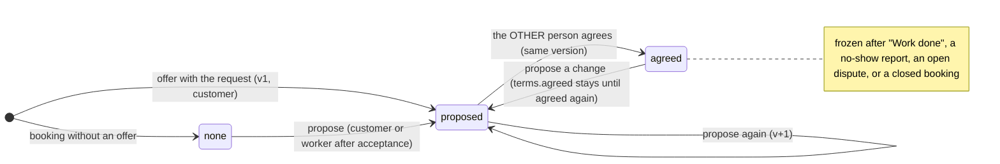
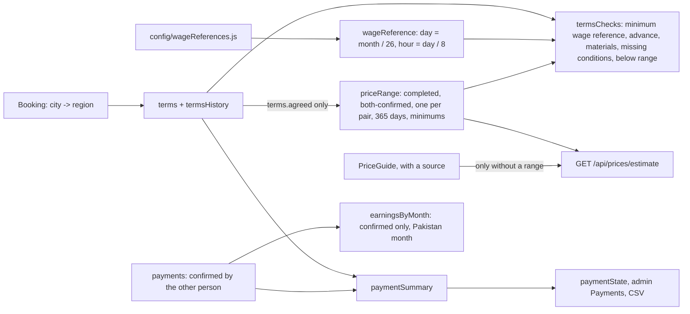

# Module 5 — Fair Wage and Work Protection (Batch 7)

**Owner in the proposal's work split: Shahzaib Khan.** Built in Batch 7 (19–23 Nov 2026) on the Work Booking of
Module 4. Team choice of 19 Nov 2026 (not a supervisor approval): **option C** — the government minimum wage as a
reference, the platform's own completed-job prices, and an admin price guide with a written source as the fallback
(decision D-067).

> **What this module is not.** Module 5 is **not** the core research contribution of the project (that is
> Modules 4 and 7). It is not a "fair wage estimator": it shows a **price range** ("typical price on this
> platform"), never a "fair price". It is not AI: every check is a fixed rule. The app **never moves money**.

## 1. What the module does (the proposal's bullets)

| Proposal bullet | What it is in the app | Where |
|---|---|---|
| Display of estimated wage or price information for selected work categories | The price information card: the platform range (25th–75th percentile with the median, only from enough confirmed jobs) or the admin guide with its source, the minimum wage reference for the region, the worker's own stated rates | `services/wage/priceRange.js`, `GET /api/prices/estimate`, `PriceInfoCard`, request form, Price information page |
| Recording of agreed payment amounts between customers and workers | Price terms on the booking: amount, unit, quantity, total, conditions; versions; both must agree | `Booking.terms`, `termsHistory`, `POST /api/bookings/:id/terms` and `/terms/agree`, `TermsForm`, `TermsSummary` |
| Identification of important payment and work conditions | A checklist per trade category and seven rule-based checks (warn, never block) | `config/workTerms.js`, `services/wage/termsChecks.js`, `POST /api/prices/check`, `ChecksList` |
| Presentation of work-protection information to workers and customers | Short tips for the ear (both roles), safety advice per trade, helplines with sources, the minimum wage table | `ProtectionCard`, Help Centre "Fair pay and safe work", `GET /api/meta/wage-references` |
| Maintenance of payment-related records associated with completed work | Payment records confirmed by the other person, a summary, My earnings, a printable record, admin Payments and CSV | `Booking.payments`, `paymentRules.js`, `paymentSummary.js`, `PaymentsCard`, My earnings, `PaymentRecord`, `AdminPayments` |

For whom: workers (agree a price before starting, keep a record of every payment, see their confirmed earnings),
customers (see what the work usually costs, agree conditions, record what they paid), admins (price guide with
sources, read-only payments overview).

## 2. States

```mermaid
stateDiagram-v2
  direction LR
  [*] --> awaiting_confirmation: "I paid" (customer) / "I received" (worker)
  awaiting_confirmation --> confirmed: the OTHER person: "Yes"
  awaiting_confirmation --> disputed: the OTHER person: "This is not right" (reason)
  note right of disputed: never edited or deleted; a mistake is disputed and recorded again; Module 9 decides later
```

## 3. Data flow

The engines (`regions`, `wageReference`, `termsChecks`, `priceRange`, `termsRules`, `paymentRules`,
`paymentSummary`, `earningsByMonth`) are pure: plain data in, plain data out, `now` passed in, no randomness. The
live API and the simulator import the same files.

## 4. The formulas and the worked examples (config: `backend/config/wageRules.js`, all provisional)

**Price range** (D-070): sort the agreed per-unit amounts `x[0..n−1]`, `h = (n − 1) p`, `j = floor(h)`,
`Q(p) = x[j] + (h − j)(x[j+1] − x[j])` (Hyndman & Fan 1996, definition 7), for p = 0.25, 0.5, 0.75; each rounded to
the nearest Rs 50, halves up. Minimums: 5 jobs, 3 workers, 3 customers; one job per customer–worker pair; 365 days.

| Case | Amounts (after the filters) | low | median | high | Note | Test |
|---|---|---|---|---|---|---|
| A | 1000, 1500, 2000, 2500, 3000 | 1500 | 2000 | 2500 | the mean is also 2000 | pass |
| B | 800, 1000, 1200, 1500, 1800, 5000 | 1050 | 1350 | 1750 (1725) | the mean would be 1883.33 | pass |
| C | 2000 … 4500 (7 jobs) | 2350 | 3000 | 3750 | | pass |
| D | 700, 900, 1100, 1250, 1400 | 900 | 1100 | 1250 | | pass |
| E | case A from 2 workers | `null` | | | 3 workers needed; the next level is tried | pass |
| F | case A + 3 × 9000 from one pair | 1650 (1625) | 2250 | 2900 (2875) | without the pair rule: 1900 · 2750 · 9000 | pass |
| G | 5 jobs, one `auto`, one proposed-only | `null` | | | 3 remain | pass |
| H | 5 jobs, one 400 days ago | `null` | | | outside 365 days | pass |

(`backend/tests/unit/priceRange.test.js`; the hand calculation of every number is in the test's comments.)

**Minimum wage reference** (D-068): `daily = round(monthly / 26)`, `hourly = round(monthly / 26 / 8)`, halves up.
Low-pay checks: ICT day 1564 → warning, 1565 → none; ICT hour 195 → warning, 196 → none; PB job one day 1200 →
warning; PB job 2–3 days 2500 → warning (2 × 1538 = 3076); PB job a few hours 500 → no check; unknown city → no
check (`backend/tests/unit/termsChecks.test.js`, all pass).

**Payment summary** (D-076): `state` in this order: `has_dispute` (any disputed record), `no_price`, `paid`
(confirmed ≥ agreed total), `part_paid`, `not_paid`. Over-payment: 3,000 against 2,500 → `paid`, balance −500,
"Rs 500 more than the agreed price". Materials money is apart (`backend/tests/unit/termsPaymentRules.test.js`).

## 5. The minimum wage reference: figures, sources and the yearly update

Figures as given by the team, checked on **19 Nov 2026**; **Balochistan and Khyber Pakhtunkhwa checked again and
corrected on 23 Nov 2026** to the notified figures (a data correction; see `docs/CHANGELOG.md`). Monthly minimum wage for
adult unskilled workers; the notifications count 26 working days a month and 8 hours a day. They live only in
`backend/config/wageReferences.js`.

| Region | Monthly (Rs) | Day | Hour | Effective from | Status | Sources (in the config and the Help Centre) |
|---|---|---|---|---|---|---|
| ICT | 40,700 | 1,565 | 196 | 1 Jul 2026 | notified (19 Aug 2026) | WageIndicator (Islamabad, 1 Jul 2026); The News |
| SD | 43,000 | 1,654 | 207 | 1 Jul 2026 | notified (17 Aug 2026) | WageIndicator (Sindh, 1 Jul 2026); Express Tribune, 6 Aug 2026 |
| PB | 40,000 | 1,538 | 192 | 1 Jul 2025 | notified (8 Sep 2025); reported unchanged in the 2026-27 budget | Business Recorder, 10 Sep 2025; WageIndicator Punjab page; ARY News, 19 Jun 2026 |
| KP | 40,000 | 1,538 | 192 | 1 Jul 2025 | notified (date not confirmed); checked 23 Nov 2026. Note only: Rs 45,000 announced in the 2026-27 budget, notification not found | Profit, KP notification of Rs 40,000 |
| BA | 37,000 | 1,423 | 178 | 1 Jul 2024 | notified (date not confirmed); checked 23 Nov 2026 | WageIndicator Balochistan page ("Unskilled Workers Minimum wage with effect from July 1, 2024: PKR 37,000") |
| GB, AJK | — | — | — | — | no figure: no minimum-wage check | — |

General source for the laws and the 26-day / 8-hour convention: FAFEN, "Minimum Wage in Pakistan: Laws, Process and
Current Rates". Shown always with the region, the status in words, the effective date and the line "These laws are
written for workers in shops and factories. The app shows the figure as a reference so that a day's work is not
paid less."

**Yearly update (every July).** The team checks each provincial labour department's notification and the federal
notification for Islamabad, updates `monthly`, `effectiveFrom`, `status`, `statusDate`, `sources` and `checkedOn` in
`backend/config/wageReferences.js`, runs the tests, and commits. The age is visible, not silent: the Help Centre
shows "checked on …" under the table and the admin Overview shows a banner when any figure was checked more than
365 days ago (`referenceAge`, unit-tested with an injected date). **Before going live** the team checks every figure
against the official notification (docs/MODULE-5-MANUAL-TEST.md, first section); if a figure differs, the team
changes it, not Claude.

## 6. Who sees what (privacy)

- The price range shows aggregates only, and only with ≥ 5 jobs from ≥ 3 workers and ≥ 3 customers;
  `GET /api/prices/estimate` never returns a list of amounts, a booking id, a name or a worker id (tested).
- Terms and payments: only the two people in the booking and admins (`GET /api/bookings/:id`). Lists (`/mine`)
  get the terms state, the agreed total, the waiting offer's price (so the worker's Requests card can show and read
  it) and the payment state; never the conditions, notes or records.
- Notes (terms, payment disputes, guide notes) go through the contact-info check (`TEXT_HAS_CONTACT_INFO`), so no
  phone number passes before acceptance (D-002). Phone numbers only as D-002 / D-052 allow (re-tested with terms and
  payments present).
- Notifications carry only `amount`, `unit`, `paymentId` in addition to the Module 4 params: never a name, a phone
  number or a note. A low-pay warning is never a notification.
- The payments CSV: booking code, skill, category, region, unit, agreed total, confirmed / awaiting / disputed,
  state, dates, `synthetic`. No names, phone numbers or notes. Audited (`export.payments`).
- Audit entries (no phone numbers, no note text): `terms.proposed`, `terms.agreed`, `payment.recorded`,
  `payment.confirmed`, `payment.disputed`, `priceguide.created/updated/archived`, `export.payments`.

## 7. Extension points (do not build them in this module)

- **Module 6 (job posting):** may read `terms.agreed.unit`, `terms.agreed.total` and the `priceRange` output to
  suggest a budget (docs/contracts/PRICE-INPUTS.md).
- **Module 7 (matching):** may read the same, plus `paymentSummary.state`; never rank workers by price alone.
- **Module 8 (digital work agreement):** reads `Booking.terms.agreed` and `termsHistory` to build the formal
  agreement (work timeline, written scope, before-and-after photos, a sealed version). The comment block in
  `models/Booking.js` names this.
- **Module 9 (disputes):** decides payment records marked `disputed` (today only marked and shown, D-078).

## 8. Evaluation by simulation: how robust is the price range? (SIMULATION results)

Harness: `backend/evaluation/price-range/` (README with every assumption), `npm run evaluate:price-range --
--scenario all --seeds 30`. 40 markets per seed (one skill in one city, unit `job`), a hidden typical price `m` ~
Uniform(1,000, 6,000), genuine prices `round(m × exp(ε))`, `ε ~ Normal(0, 0.35)` (an assumption), jobs per market
geometric with mean 8 (`sparse`: 3), 10% `auto`, 20% proposed-only, 15% repeat pairs, 20 held-out genuine prices per
market. Methods: M1 plain mean, M2 plain median (both read every completed job with any price, no minimums), ours =
the production `priceRange`, imported (rounded to Rs 50; M1/M2 are not). **These are simulation results with assumed
price spreads and assumed attacks.** No success criteria were fixed before the run.

**SIMULATION — scenario `base`** (as described in the README; 30 seeds 20261119–20261148; parameters `91c1ab6e0c51`; run 2026-11-19 at `be625c2`; file `SIMULATION-price-2026-11-19-base.json`). Each cell: mean (sd) [2.5th–97.5th percentile] over seeds.

| Method | availability | error | coverage |
|---|---|---|---|
| M1 plain mean (no rules) | 0.887 (0.039) [0.818–0.957] | 0.108 (0.025) [0.073–0.158] | 0.549 (0.043) [0.469–0.620] |
| M2 plain median (no rules) | 0.887 (0.039) [0.818–0.957] | 0.117 (0.027) [0.075–0.169] | 0.329 (0.031) [0.265–0.380] |
| ours (production priceRange) | 0.348 (0.097) [0.193–0.502] | 0.097 (0.040) [0.041–0.182] | 0.400 (0.046) [0.331–0.490] |

Paired, ours minus other, seed by seed (mean difference, share of seeds where ours is better): vs M1: availability -0.539 (0%), error -0.011 (67%); vs M2: availability -0.539 (0%), error -0.020 (77%).

**SIMULATION — scenario `sparse`** (a young platform: mean 3 jobs per market; 30 seeds 20261119–20261148; parameters `b8cf112cccdd`; run 2026-11-19 at `be625c2`; file `SIMULATION-price-2026-11-19-sparse.json`). Each cell: mean (sd) [2.5th–97.5th percentile] over seeds.

| Method | availability | error | coverage |
|---|---|---|---|
| M1 plain mean (no rules) | 0.769 (0.066) [0.668–0.907] | 0.141 (0.036) [0.081–0.198] | 0.411 (0.054) [0.323–0.514] |
| M2 plain median (no rules) | 0.769 (0.066) [0.668–0.907] | 0.148 (0.038) [0.081–0.209] | 0.223 (0.034) [0.165–0.284] |
| ours (production priceRange) | 0.106 (0.048) [0.018–0.189] | 0.123 (0.067) [0.034–0.283] | 0.370 (0.101) [0.171–0.548] |

Paired, ours minus other, seed by seed (mean difference, share of seeds where ours is better): vs M1: availability -0.663 (0%), error -0.019 (69%); vs M2: availability -0.663 (0%), error -0.026 (66%).

**SIMULATION — scenario `inflator`** (in 30% of markets one worker adds 4 jobs at 2.5 x m with 2 fake customer accounts (both-confirmed, recent); 30 seeds 20261119–20261148; parameters `626d48bc4825`; run 2026-11-19 at `be625c2`; file `SIMULATION-price-2026-11-19-inflator.json`). Each cell: mean (sd) [2.5th–97.5th percentile] over seeds.

| Method | availability | error | coverage | attackShift |
|---|---|---|---|---|
| M1 plain mean (no rules) | 0.927 (0.038) [0.843–0.975] | 0.193 (0.065) [0.090–0.310] | 0.541 (0.046) [0.458–0.622] | 0.600 (0.111) [0.380–0.783] |
| M2 plain median (no rules) | 0.927 (0.038) [0.843–0.975] | 0.153 (0.039) [0.098–0.226] | 0.337 (0.039) [0.278–0.404] | 0.642 (0.190) [0.261–0.935] |
| ours (production priceRange) | 0.388 (0.084) [0.250–0.539] | 0.120 (0.039) [0.073–0.217] | 0.440 (0.055) [0.348–0.566] | 0.086 (0.041) [0.009–0.162] |

Attacked markets where the attack made a number appear (all seeds): M1 plain mean (no rules): 47; M2 plain median (no rules): 47; ours (production priceRange): 48.

Paired, ours minus other, seed by seed (mean difference, share of seeds where ours is better): vs M1: availability -0.538 (0%), error -0.074 (90%), attackShift -0.510 (100%); vs M2: availability -0.538 (0%), error -0.033 (80%), attackShift -0.553 (100%).

**SIMULATION — scenario `pair_flood`** (in 30% of markets one customer-worker pair adds 6 jobs at 2 x m; 30 seeds 20261119–20261148; parameters `b0ccd5cd0966`; run 2026-11-19 at `be625c2`; file `SIMULATION-price-2026-11-19-pair_flood.json`). Each cell: mean (sd) [2.5th–97.5th percentile] over seeds.

| Method | availability | error | coverage | attackShift |
|---|---|---|---|---|
| M1 plain mean (no rules) | 0.927 (0.038) [0.843–0.975] | 0.190 (0.061) [0.090–0.301] | 0.509 (0.046) [0.417–0.586] | 0.469 (0.083) [0.321–0.610] |
| M2 plain median (no rules) | 0.927 (0.038) [0.843–0.975] | 0.168 (0.043) [0.104–0.250] | 0.324 (0.042) [0.252–0.398] | 0.605 (0.138) [0.329–0.826] |
| ours (production priceRange) | 0.368 (0.089) [0.225–0.521] | 0.111 (0.039) [0.060–0.200] | 0.418 (0.047) [0.344–0.519] | 0.039 (0.023) [0.002–0.080] |

Attacked markets where the attack made a number appear (all seeds): M1 plain mean (no rules): 47; M2 plain median (no rules): 47; ours (production priceRange): 24.

Paired, ours minus other, seed by seed (mean difference, share of seeds where ours is better): vs M1: availability -0.558 (0%), error -0.080 (90%), attackShift -0.426 (100%); vs M2: availability -0.558 (0%), error -0.057 (93%), attackShift -0.558 (100%).

**What the simulation shows (SIMULATION, 30 seeds each).** In this simulated world the rules cost availability:
ours gives a number in about a third of the markets (`base` 0.348) where the naive methods give one in almost nine of
ten (0.887), and on a young platform (`sparse`) in about one market in ten (0.106). Where ours gives a number, its
median error is a little smaller (`base` 0.097 vs 0.108 and 0.117), and the two attacks move it much less (attack
shift 0.086 vs 0.600 / 0.642 for `inflator`, 0.039 vs 0.469 / 0.605 for `pair_flood`; ours better in 100% of seeds).

**What it does not show.** It does not show what real prices look like: the log-normal spread and the two attacks are
assumptions. The attacks can still make a range **appear** in a market that had too few jobs (48 markets for
`inflator`, 24 for `pair_flood`, over all seeds): two fake customers, or one new pair that adds one more job, can tip
a market over the minimums; the shift of those markets cannot be measured (there is no "before"). A worker with 3 or
more fake customer accounts is not stopped by the rules. The coverage of the middle half is below 0.5 here (0.400 in
`base`): with few jobs a sample's middle half is narrow (a sanity check, not a target). Real prices are needed:
`docs/evaluation/PRICE-PILOT-PLAN.md` (a plan only, no results).

## 9. Limitations (stated plainly)

- **No real price data yet.** The platform range appears only after enough both-confirmed jobs; the simulation
  measures how late (availability). Until then the admin guide (empty in production) or nothing is shown.
- **Minimum wages are written for establishments** (shops and factories), not for a household hiring a plumber for
  a day; they are shown as a reference, never as a legal requirement. Enforcement in Pakistan is weak (PIDE 2026).
- The KP and BA figures are the **notified** figures found on 23 Nov 2026 (KP from 1 Jul 2025, BA from 1 Jul 2024). KP
  announced Rs 45,000 in the 2026-27 budget, but no notification was found; when one is found, the team updates the
  config. The table can become outdated: it must be checked every July.
- **Unknown cities** (not in the table) get no minimum-wage check and no region level.
- **Fake accounts:** the minimums limit one person or one pair; three or more fake customers can still move a young
  market (§8). Admin review of unusual patterns remains necessary.
- **Disputes are only marked**; nothing decides them until Module 9.
- **Monthly domestic employment** (a maid hired by the month) is not covered: a booking is one piece of work; the
  domestic-work note only reminds people of the 8-hour day.
- The app records what people say they paid; it cannot know whether money really changed hands.

## 10. How to explain this in the viva

- **Is this AI?** No. Every number comes from a fixed, written rule: percentiles of agreed prices, a division of a
  government figure by 26 and 8, and seven if-then checks. Nothing is learned or predicted; no external AI service.
- **Why the median and not the average?** One extreme price moves an average a lot but the median very little (the
  median ignores up to half the values; Hampel 1971). Case B: one price of 5,000 pulls the average to 1,883 while the
  median stays 1,350.
- **Why at least 3 workers and 3 customers?** For privacy (nobody can work out one person's price) and so that one
  person or one friendly pair cannot set the "typical price".
- **Can a worker push the typical price up?** One worker with one friend cannot: a pair counts once, and 3 workers and
  3 customers are needed. A worker who creates several fake customer accounts can still push it on a young platform;
  the simulation shows the shift is small (0.086 of the true price in `inflator`, SIMULATION) but the attack can make a
  range appear. That is a known limit.
- **Why show the minimum wage if the law may not cover these jobs?** As a reference point that people recognise, so a
  full day of work is not paid less than the government's own floor for unskilled work. The app says plainly that the
  law is written for shops and factories, and it never blocks a price.
- **Why can payments not be edited?** A record that can be changed later can be bargained over. A mistake is
  corrected openly: the other person marks it "not right" and a new record is made; both stay in the history and in
  the audit log.
- **Why does the app not take payments online?** Out of scope (escrow, wallets and commissions need a licence and
  carry risks); and many workers are paid in cash. The app keeps a record both people confirm.
- **Where do the admin guide numbers come from?** Only from a source the admin writes down (for example a team
  survey); the source and the month are shown to users. Production starts empty; nobody types a guess.
- **What happens in a city the app does not know?** No region: no minimum-wage check and no regional range; the city
  level and the all-Pakistan level of the range still work. The app never guesses the province.

## 11. Deployment notes (not deployed in this batch)

- No new environment variable. No migration (old bookings have no terms; their `region` stays empty and they never
  enter the price statistics).
- After the deploy, run `npm run db:indexes` once against Atlas (new booking indexes, the `priceguides` collection).
- **Check the wage figures first** (docs/MODULE-5-MANUAL-TEST.md, first section).
- The production price guide starts empty; add entries only with a written source.

## References

- Hyndman, R. J., & Fan, Y. (1996). Sample Quantiles in Statistical Packages. *The American Statistician*, 50(4),
  361–365. https://doi.org/10.1080/00031305.1996.10473566
- Hampel, F. R. (1971). A General Qualitative Definition of Robustness. *The Annals of Mathematical Statistics*,
  42(6), 1887–1896. https://doi.org/10.1214/aoms/1177693054
- FAFEN. Minimum Wage in Pakistan: Laws, Process and Current Rates. https://fafen.org/minimum-wage-in-pakistan-laws-process-and-current-rates/
- PIDE (2026). Reforming Minimum Wage Determination in Pakistan: From Wage Announcements to Wage Governance. Policy
  Viewpoint No. 62. https://pide.org.pk/research/reforming-minimum-wage-determination-in-pakistan-from-wage-announcements-to-wage-governance/
  (context only)
- Express Tribune (9 Nov 2026). Punjab's labour law extends legal coverage (Punjab Labour Helpline 1314).
  https://tribune.com.pk/story/2639368/punjabs-labour-law-extends-legal-coverage
- Islamabad Police, Pucar-15 ("For Emergency Call: 15"). https://islamabadpolice.gov.pk/r15.php
- Rescue 1122 (overview). https://en.wikipedia.org/wiki/Rescue_1122 (the team should replace this with the official
  provincial site in the Help Centre)
- The wage sources of §5 (in `backend/config/wageReferences.js`).
