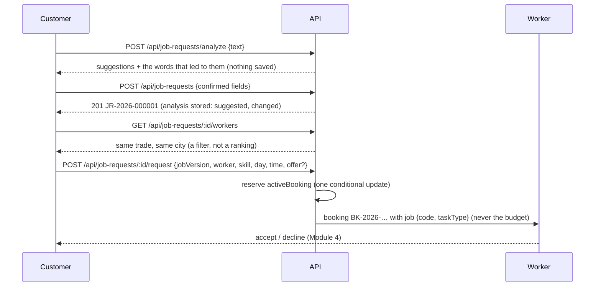

# Module 6 — Problem/Job Analyzer (Batch 8A: backend, analyzers, evaluation harness; Batch 8B: the screens)

Status (24 Nov 2026): **Batch 8A done** (the backend, the two analyzers, the evaluation harness and the documents) and
**Batch 8B done** (the customer and admin screens, §14; the results of the check of Batch 8A, §14.8; word lists
`2026-11-24-v3`; the final consent and form texts). The evaluation on real data is **Batch 8C** (no real data exists
yet). Owner in the proposal's work split: Usama Asif. Decisions D-080 to D-091 and D-092 to D-101 (`docs/DECISIONS.md`).

**Honest words.** The website never says "AI". The rule-based analyzer is "rule-based word lists". The classifier is
"a naive Bayes classifier: a simple word-count model trained on the team's labelled examples". No suggestion ever
shows a probability, a percentage or a score.

## 1. What the module does

The proposal's Module 6, "AI Problem/Job Analyzer":

| Proposal | What is built (8A) |
|---|---|
| a. Submission of a new job by the customer | `POST /api/job-requests` (the confirmed job), with limits, edit with versions, close, delete |
| b. Text-based analysis of job descriptions | `POST /api/job-requests/analyze`: rule-based word lists (live) and the team's naive Bayes classifier + a hybrid (compared, not live) |
| c. Skills, task type, location and work requirements | trade, skills, task type, city (and region), day, time, urgency, budget, an address hint |
| d. Job attributes for matching | `toMatchingQuery(job)` (`docs/contracts/JOB-PROFILE.md`) and "workers for this job" (a filter) |
| e. A structured job profile | the saved `JobRequest`, confirmed by the customer, with the analysis stored next to it |

Team decisions (23 Nov 2026; team choices, not supervisor approvals): (1) a rule-based analyzer **and** the team's
own small classifier, compared on the same real data; the customer confirms every suggestion; no external service.
(2) The **customer chooses the worker** from "workers for this job"; the request to the worker carries the job;
**workers never see a list of jobs**. (3) The team collects 150+ real descriptions with consent; two members label.

## 2. The job request: states and the request flow

Only `status` (`open` | `closed`) is stored. The state is **derived** (`services/jobs/state.js`, pure), in this order:

1. `status = closed` → **closed**
2. a booking from this job is `completed` → **done**
3. a booking is `accepted` → **accepted**
4. a booking is `requested` → **requested**
5. more than 30 days since it was saved → **expired** (no cron job)
6. otherwise → **open**

| State | Edit | Find workers | Request a worker | Close | Delete |
|---|---|---|---|---|---|
| open | yes | yes | yes | yes | only if no booking was ever made from it |
| requested | no | yes | no | yes | no |
| accepted | no | yes | no | yes | no |
| done | no | no | no | yes | no |
| expired | no | no | no | yes | only if no booking was ever made from it |
| closed | no | no | no | no | only if no booking was ever made from it |

Closing a job never changes its bookings (an accepted booking goes on under the Module 4 rules). Before any state is
computed, the due booking timers of the job's bookings run (`sweepBookings`), so a 48-hour unanswered request counts
as expired.

**One request at a time (D-081)** through a reservation (D-082): the request route reads the job's `activeBooking`,
runs every check of `POST /api/bookings` (one shared code path, `services/booking/create.js`) plus "the skill is in the
job's trade" (`BOOKING_JOB_MISMATCH`), then moves `activeBooking` from the value it read to a new booking id with one
conditional update (`_id`, `customer`, `status: open`, `version`, `activeBooking`). Two taps at once: exactly one 201,
one 409 `JOB_HAS_OPEN_REQUEST` (tested). If writing the booking fails, the reservation is released. A reservation whose
booking does not exist counts as taken for 60 seconds (its id holds its own creation time), then as free (a crashed
request never blocks a job for ever). The booking copies `city`, `area` and `description` from the job (the job is the
one source) and stores `jobRequest`, `jobCode`, `jobTaskType`. A booking without a job has **no** `job` key at all.

## 3. The rule-based analyzer `job-rules-1` (live)

`services/jobAnalyzer/rules.js` (pure); word lists in `config/jobPhrases.js` (version `2026-11-24-v3`: v1 plus two
fixes from the independent review of Batch 8A (v2) and the results of the check of Batch 8A (v3, Batch 8B), all
written before any real data, for team review; improved in Batch 8C on the development set only).

- **Normalisation:** Module 2's `normalizeText` + a Roman Urdu spelling-variant map (`nhi/nahin/nai → nahi`,
  `kr → kar`, `gya → gaya`, …; 47 words, 90 variants), applied to the text **and** to every term. Module 2 is
  unchanged (its output is byte-for-byte the same; checked).
- **Trade and skills:** the taxonomy's strong and weak terms + **problem phrases** per skill (188 phrases, 44 in Urdu
  script), because customers describe symptoms ("nalka tapak raha hai") rather than trades. Phrases count as strong.
  A weak term counts only if the same trade has strong evidence (Module 2's rule), and a phrase is strong evidence.
  Whole words and word sequences only, never parts of words. `a + b` phrases need both parts anywhere ("deewar mein
  bari darar"). Trades are ordered by the number of distinct matched words; a **tie is reported, never decided**.
- **Task type:** the first list with a word in the text, in this order: install, repair, service, cleaning, moving,
  household help, new work; else the trade's usual work (masonry, painting, carpentry → new work; moving → moving;
  domestic → cleaning when the cleaning skill was found, else household help; the others → none).
- **City:** any spelling of the city table as a whole word sequence; two different cities → no suggestion and the
  note `city_conflict`; a longer name wins ("Mirpur Khas" is not also "Mirpur"); never a guess for an unknown place.
  Since v3 (Batch 8B, A1 and A2): the five spellings that are also everyday words (`atak` / `اٹک` = stuck, `wah`,
  `mari`, `مری`) name the city **only directly before a place word** (`میں`, `سے`, `کے`, `کی`, `کا`, `تک`, `mein`,
  `me`, `se`, `ke`, `ki`, `ka`, `tak`): "مری میں نلکا ٹپک رہا ہے" → Murree, "پائپ میں کچھ اٹک گیا ہے" → none; a city
  spelling **directly before a road word** (`road`, `rd`, `روڈ`, `chowk`, `چوک`) is a road, not the city: "Murree Road
  Rawalpindi par plumber chahiye" → Rawalpindi, no conflict. The longer name is chosen first ("Mirpur Khas Road" is
  neither Mirpur Khas nor Mirpur). Known limit: "atak ke" (having got stuck) reads as "Attock ke".
- **Day, time, urgency** (with `now`, Pakistan time): aaj / kal / parson → today / tomorrow / day after and a date;
  subah / dopahar / shaam → morning / afternoon / evening (night: no slot); jaldi, foran, urgent, emergency, abhi.
- **Budget** (from the raw text): a number is money only next to a money word (Rs, rupay, budget, روپے, …), with a
  multiplier (2 hazar, 1.5k, dedh lakh) or with "/-"; the unit (day, hour, else whole job) only within 3 words;
  outside Rs 100 – 5,000,000 → no suggestion and the note `budget_out_of_range`; two amounts → none.
- **Address hint:** "house no 12", "gali number 5", "makan 12", "مکان نمبر 7", … → the note `address_in_text` (never
  blocks; Batch 8B asks the customer to remove it).
- **Output** (the same shape for every method): `method`, `methodName`, `versions`, `category` (`suggested`, `tie`,
  `ranked`, `matched`, `source`, `words`), `skills`, `taskType`, `city`, `when`, `timeSlot`, `urgent`, `budget`,
  `notes`, `missing` (always `area`; `category` and `city` when not suggested). No score anywhere.

**The 13 required examples** (unit tests; `now` = 2026-11-24 10:00 PKT; real output of the code):

| # | Text (SYNTHETIC) | Trade (words) | Skills | Task type | City, day, time, urgency, budget | Notes | Still needed |
|---|---|---|---|---|---|---|---|
| 1 | Kal subah AC ki service karwani hai, Rawalpindi mein | `ac_appliance_repair` (ac, service) | ac_general, ac_service | service | city Rawalpindi (PB); tomorrow 2026-11-25; morning | — | area |
| 2 | Bathroom ka nalka tapak raha hai, jaldi koi plumber bhej dein | `plumbing_sanitary` (plumber, tapak, nalka, bathroom) | plumb_general, plumb_leak, plumb_fixtures | repair | urgent | — | city, area |
| 3 | پنکھا نہیں چل رہا، آج شام کو کوئی آ جائے | `electrical_solar` (پنکھا) | elec_fittings | repair | today 2026-11-24; evening | — | city, area |
| 4 | Ghar shift karna hai Lahore mein, budget 15,000 rupay | `moving_loading` (shift karna, ghar shift) | move_shifting | moving | city Lahore (PB); budget 15000/job | — | area |
| 5 | Need a painter for two rooms, around Rs 2 hazar per day | `painting_renovation` (painter) | paint_general | new_work (trade default) | budget 2000/day | — | city, area |
| 6 | AC thanda nahi kar raha, gas bharni hai | `ac_appliance_repair` (ac, thanda nahi, gas bharni) | ac_general, ac_gas | repair | — | — | city, area |
| 7 | Mujhe kal ek electrician aur ek plumber chahiye | tie: electrical_solar, plumbing_sanitary | elec_general, plumb_general | — | tomorrow 2026-11-25 | category_tie | category, city, area |
| 8 | Hello, kya haal hai | — | — | — | — | no_trade_words | category, city, area |
| 9 | Gali number 5, makan 12 mein wiring ka kaam hai | `electrical_solar` (wiring) | elec_wiring | — | — | address_in_text | city, area |
| 10 | کراچی میں گیزر لگوانا ہے | `plumbing_sanitary` (گیزر) | plumb_geyser | install | city Karachi (SD) | — | area |
| 11 | Pindi se Islamabad samaan shift karna hai | `moving_loading` (shift karna, samaan shift, samaan) | move_shifting, move_loading | moving | two cities | city_conflict | city, area |
| 12 | AC repair ke liye Rs 50 | `ac_appliance_repair` (ac) | ac_general | repair | — | budget_out_of_range | city, area |
| 13 | kharab pankha utaar kar naya lagana hai | `electrical_solar` (pankha) | elec_fittings | install | — | — | city, area |

Module 2's `extractSkills` as it is misses `plumb_leak` in 2 and `ac_gas` in 6 and finds nothing in 4 and 11 (a test
checks it): exactly the gaps the problem phrases close. Whether that helps on real data is what Batch 8C measures.

Try it (in `./backend`): `npm run jobs:try -- "Kal subah AC ki service karwani hai"` (`--now <ISO time>`,
`--model <model.json>` also shows the classifier and the hybrid). No database, nothing saved.

## 4. The naive Bayes classifier and the hybrid (compared; not live in 8A)

`services/jobAnalyzer/naiveBayes.js`: multinomial naive Bayes in plain JavaScript (McCallum & Nigam 1998; Manning,
Raghavan & Schütze 2008, ch. 13), trained only on the team's labelled development data.

- features: the analyzer's tokens (normalisation + variants); with `ngram = 2` also adjacent pairs
- vocabulary `V`: features in at least `minDf` **training** documents; never a feature with 3+ digits in a row
- prior `P(c) = N_c / N`; likelihood (Lidstone) `P(t | c) = (T_ct + α) / (Σ_t' T_ct' + α·|V|)`
- score `s(c | d) = log P(c) + Σ_t n_t(d) · log P(t | c)`; prediction = the highest score; ties → the earlier label
- the website may show `ranked` (top 3) and `words` (up to 5 features with the largest positive
  `n_t(d) · [log P(t | c1) − log P(t | c2)]`), **never** the scores: naive Bayes "probabilities" are badly calibrated
  and would read like a certainty.

**Hand-worked example** (unit tests, 4 decimals). Training: A "fan kharab", A "fan wiring", B "pipe leak"; α = 1,
unigrams, minDf = 1.

| Quantity | Value |
|---|---|
| P(A), P(B) | 0.6667, 0.3333 |
| P(fan\|A), P(kharab\|A), P(wiring\|A), P(pipe\|A), P(leak\|A) | 0.3333, 0.2222, 0.2222, 0.1111, 0.1111 |
| P(fan\|B), P(pipe\|B), P(leak\|B), the other two | 0.1429, 0.2857, 0.2857, 0.1429 |
| "fan leak": s(A), s(B), prediction, margin | −3.7013, −4.2973, A, 0.5960 |
| "fan leak": words | [fan] (0.8473; leak is −0.9445) |
| "pipe": s(A), s(B), prediction, margin | −2.6027, −2.3514, B, 0.2513 |
| "tap fan" (tap unknown) | −1.5041, −3.0445, A, 1.5404 |
| minDf = 2: vocabulary, "fan leak" | [fan]; A (equal likelihoods, the prior decides) |

The model is deterministic (the same items in any order give a byte-identical model; tested), has a `modelId` from
its content, and keeps only the file **name** of its training data.

**The hybrid (fixed in 8A):** the trade from the rules when they give one (not empty, no tie); otherwise the
classifier's top label (`category.source` says which). Everything else always comes from the rules; when the trade came
from the classifier, only the rules' skills of that trade are kept.

When the hybrid's trade comes from the classifier, the task type's trade default (step 7 of the task-type rule) uses
that trade: this behaviour **is** pre-registered, because the frozen `PROTOCOL.md` (at `81ba8f6`, "What is compared")
says so, and the frozen text decides over the older wording of the Batch 8A plan (review finding 6; the code is
unchanged).

**Live use:** `config/jobAnalyzer.js` — `LIVE_METHOD = 'rules'`, `LIVE_MODEL = null` (D-085). A future model is an
ES module (`config/jobModel.generated.js`, `jobs:train --format js`) imported statically so Vercel bundles it. In
production a model trained on synthetic data is refused (the server uses the rules and logs one line without text).

## 5. The evaluation (protocol frozen; synthetic data only so far)

The protocol is **pre-registered** in [`docs/evaluation/job-analysis/PROTOCOL.md`](../evaluation/job-analysis/PROTOCOL.md),
**frozen at commit `81ba8f6`** (24 Nov 2026, 01:10 PKT), before any real description exists. In one sentence each:

- **Which method goes live:** if `max(Acc_nb, Acc_hybrid) − Acc_rules ≥ 0.03` on the test set, the better of nb and
  hybrid goes live (hybrid if they are within 0.01); otherwise the rules stay live.
- **What may be claimed:** "A is more accurate than B" only if McNemar's exact p after Holm's correction over the three
  comparisons is below 0.05 (and the test set has at least 60 items with a trade); otherwise "no significant
  difference was found on n items".

The harness (`backend/evaluation/job-analysis/`): stratified split 40/60 (seed 20261124), 5-fold cross-validation on
the development file only (12 settings; vocabulary inside each training fold), the systems (rules, three ablations,
Module 2 as it is, majority, nb, nb without variants, hybrid), accuracy, coverage, selective accuracy, macro-F1 with
intervals, per script and per prompt, McNemar exact and mid-p, Holm, paired bootstrap, the other fields, agreement.
The synthetic dry run of Batch 8A only shows that the scripts run; **its numbers are not results** and are never
reported (the same author wrote the word lists and the synthetic sentences).

## 6. Who sees what (privacy)

| Data | Customer (owner) | The requested worker | Other workers | Other customers | Admin |
|---|---|---|---|---|---|
| Job description | yes | yes, as the booking's description | no | no | yes |
| Category, skills, task type | yes | task type + the booking's skill | no | no | yes |
| City, area | yes | yes, as the booking's city and area | no | no | yes |
| Preferred day, time | yes | the booking's own day and time | no | no | yes |
| Budget | yes | **no** | no | no | yes |
| Analysis (suggested, changed) | yes | no | no | no | yes |
| Any list of jobs | own only | **no** | **no** | **no** | yes |

- The description and the area pass the contact-info check (`TEXT_HAS_CONTACT_INFO`) and the CNIC check
  (`NOTE_HAS_CNIC`), like a booking's text. `POST /analyze` stores nothing and logs no text; the audit log gets no job
  text.
- Someone else's job answers 404 `JOB_NOT_FOUND` (the job is found only through a filter with the customer's id);
  workers get 403 on every job route; every schema is strict (`analysis` can never be sent by a client).
- "Workers for this job" shows only the directory's public fields and the reasons (`matchedSkills`, `sameCity`);
  never a phone number, WhatsApp, CNIC, email or address (tested).
- The admin list has no budget; the admin detail shows the customer's name only.
- Use statistics (`GET /api/admin/job-requests/stats`): aggregates only, and they describe **use, not correctness**
  (D-088): a customer may keep a wrong suggestion or change a right one.

## 7. The contract for Module 7

`toMatchingQuery(job)` → `{ category, skillIds, taskType, city, marketCity, region, preferredDate, timeSlot, urgent }`
(`docs/contracts/JOB-PROFILE.md`). Never the budget; the description is for people; add fields, never rename them.

## 8. Extension points (not built here)

- **Module 7 (matching and fair exposure):** replaces the "workers for this job" filter with ranking (from the
  matching query and `MATCHING-INPUTS.md`); never by price.
- **Module 8 (work agreement):** may start the agreement from the job's confirmed fields and the booking's agreed terms.
- **Notifications about a job** (for example "your request expired, ask someone else"): not in 8A.
- **Module 5:** a budget hint from the platform price range (`PRICE-INPUTS.md`) on the job screen (Batch 8B may show it).

## 9. Limitations (stated plainly)

- **Synthetic only so far.** No real description has been collected; nothing about the analyzers' quality is known.
- **One trade per job.** A text asking for two trades gets a tie; the customer picks one (or saves two jobs).
- **The city table only.** An unknown town gets no city suggestion and no region.
- **Weekdays and calendar dates are not read** ("Sunday", "25 tareekh"). "kal" means yesterday and tomorrow (read as
  tomorrow); Urdu "کل" can also be "kul" (all); "abhi" in "abhi tak" is read as today and urgent.
- **Spelling variants are a fixed list;** "nai" also means "new" in Roman Urdu (harmless here, but it shows the limit).
- **Budget:** ranges ("2000-3000", "10,12 hazar") and amounts without a money word ("2500 rozana") are not read; a "k"
  with a space ("5 k") is not a thousand (it is usually "ke/ki"); a monthly amount is a whole-job budget.
- **Voice typing** (8B) depends on the device's speech recognition; the analyzer only sees the text it produced.
- **A self-written word list measured on data the same team labels:** the risk of fitting the lists to the team's own
  habits; the protocol limits it (general prompt without examples, development set only, a frozen test set, a second
  labeller, agreement before discussion).
- **Small data means wide intervals;** with 150 items the test set has about 90, so only large differences can be
  significant.
- **Naive Bayes ignores word order** (bigrams help a little) and assumes words are independent given the trade.
- **The job lists read all of a customer's jobs** (and the admin list all jobs) to compute the derived states before
  paging. Fine at this project's size; a larger platform would filter on the stored status and date in MongoDB first.

## 10. Honest statement of novelty

Neither rule-based extraction nor naive Bayes is new (Chiticariu, Li & Reiss 2013 on rule-based extraction in
practice; McCallum & Nigam 1998; Wang & Manning 2012 on simple baselines). The contribution of Module 6 is: (1) a
domain analyzer for short, code-mixed (Urdu / Roman Urdu / English) household job descriptions, with Roman Urdu
spelling variants (Khan et al. 2022 describe why they are needed) and symptom phrases; (2) a newly collected,
consented, double-labelled dataset; (3) a **pre-registered** comparison of hand-written rules against a small
self-trained classifier, with a decision rule and a claim rule fixed before the data was seen.

## 11. Supervisor's guidance (24 Nov 2026, reported by the team)

1. A self-trained naive Bayes classifier, compared with the rule-based word lists, **is acceptable** as the module's
   "AI" part.
2. **No ethics approval** is needed for collecting the job descriptions. The form must say clearly that it collects
   descriptions for the project (it does: `docs/evaluation/job-analysis/consent-text.md`, `FORM-DRAFT.md`).

Decision D-091.

## 12. How to explain this in the viva

- **"Where is the AI?"** — There are two methods: hand-written word lists and a classifier that learns word counts
  from our own labelled examples. We call them by those names. The interesting part is that we compare them honestly,
  with a protocol fixed before the data existed.
- **"Why not use an existing large model?"** — The department does not accept a project that relies on pre-trained
  models or external services. It would also send customers' words to a third party, and we could not explain or
  measure it the same way.
- **"Why naive Bayes?"** — It is the standard first classifier for short texts (Manning et al. 2008), it learns from
  very little data, it is easy to write and check by hand (our hand-worked example is a unit test), and its "words that
  pushed the decision" can be shown to the customer.
- **"How do you know your analyzer works?"** — We do not know yet, and we do not claim it. The pre-registered protocol
  says how it will be measured on 150+ real descriptions labelled by two people, and what we may claim.
- **"Why can't workers see jobs?"** — Team decision: the customer chooses. A job board would show customers' needs
  (and areas) to everyone and invite bidding; a worker sees only the requests sent to them.
- **"Why one request at a time?"** — If one job went to several workers, those who accept second and third would be
  dropped: their time wasted and nobody at fault. A request expires after 48 hours, and the customer may cancel it and
  ask someone else.
- **"Show me how a customer uses it."** — The demo path of §14.6: describe the job in their own words (typed or
  spoken), see the words the app used, check and change every detail, save, choose a worker from "Workers for this
  job" and send the job. The worker sees the job code and the kind of work, never the budget.
- **"What does 'kept a suggestion' prove?"** — Only how the suggestions were used. A customer may keep a wrong one or
  change a right one; accuracy comes only from the labelled test set.

## 13. Deployment notes (not deployed in this batch)

No new environment variable. After the deploy, run `npm run db:indexes` once (in `./backend`, against the production
database) to build the `jobrequests` indexes and the new partial booking index `{ jobRequest: 1, createdAt: -1 }`.

## 14. The screens (Batch 8B)

Words on the screens (D-092): the start page is **"Describe a job"**, the list **"My job requests"**, one item a
**"job request"** (`JR-…`), its details the **"job details"**, the worker list **"Workers for this job"**; never "post a
job" (workers do not see a board). Urdu and Roman Urdu use the dictionary's words: کام کی درخواست / kaam ki darkhwast,
ہنر / hunar (skill), شعبہ / shoba (trade), کام کی نوعیت / kaam ki nauiyat (kind of work), کاریگر / karigar.

### 14.1 The customer's flow

| Page | What the customer does | API |
|---|---|---|
| `/find` | A card at the top: "Not sure whom to call? Describe the job in your own words" (🎤 hint) → Describe a job. The search below is unchanged (D-094). | — |
| `/job-requests/new`, step 1 "What do you need?" | Types or speaks (🎤, `inputMode: voice`) the job, 500 characters, 🔊 Listen, the hint "Write it as you would tell a worker…". **Check my words** marks the matched words inside the text and lists "Words we found"; it also runs when the microphone stops and before step 2 when the words changed. "How does this work?" names the live method from the API. Contact details or a CNIC → the server's message under the box; a house number → a friendly warning that never blocks. | `POST /api/job-requests/analyze` (nothing saved); `GET /api/meta/job-options` |
| step 2 "Check the details" | Every suggestion is pre-selected and says which words led to it ("Suggested from your words: ac, service"; "usual for this trade" for a trade default). Trade tiles (a tie: the tied trades first, nothing selected; no trade words: nothing selected), skills (at most 5), kind of work (7 tiles + "Not sure"), city ("Which city?" with two buttons on a conflict, from `city.candidates`, D-095), area (required, no house number), day, time, urgent, and the **private budget** with the Module 5 price information under it. | — |
| step 3 "Save" | A summary with pictures (🔊), "Your words are used for this request only", **Save** → the job page with "Now choose a worker for this job". Leaving with unsaved words asks first. | `POST /api/job-requests` (exactly the documented fields) |
| `/job-requests` | Tabs Active, Open, Waiting for a worker, Accepted, Done, Expired, Closed with the server's counts; each card: trade picture, code, kind of work, city, day and time, the state with its meaning, the main action. | `GET /api/job-requests/mine` |
| `/job-requests/:id` | The details with pictures (and the budget), the state and its meaning, only the buttons of `actions` (edit, find workers, close, delete), the requests sent from the job, and "What the app understood from your words" (collapsed: suggestion, choice, kept / changed / nothing suggested). Close: four reasons as pictures; delete: a confirmation. | `GET /api/job-requests/:id`, `POST …/close`, `DELETE …` |
| `/job-requests/:id/edit` | The same details form and the words; only changed fields are sent with `baseVersion`; `JOB_CHANGED` → "This job request was changed just now" + Reload; a changed description is analysed again by the server. | `PATCH /api/job-requests/:id` |
| `/job-requests/:id/workers` | Workers of the trade in the job's city, in the order the customer chooses (the directory's sorts) with the filters; each card says why it is listed ("Offers: Water leak repair", "Same city: Rawalpindi") and has **Send this job**. The line "The app does not rank them." Empty, truncated (500) and not-open states in plain words. | `GET /api/job-requests/:id/workers` |
| `/workers/:id/request?job=<id>` | The request page in **job mode** (D-096): a read-only "Your job" card instead of the city, area and description; only the worker's skills of the job's trade; the day and time from the job (a past or missing day → Tomorrow, with a note); the price information and the optional offer as before. Every 409/400 in plain words; a job that already waits for a worker shows the message and a link to that request. Without `?job` the page is the old one. | `POST /api/job-requests/:id/request` |

### 14.2 Honest words

No "AI", "smart", "intelligent" or "confidence" on any screen, and no percentage or score next to a suggestion (the
frontend honesty tests). A suggestion always shows the customer's own words that led to it; the method's name comes
from the API (`analyzer.methodName`, translated for Urdu and Roman Urdu), so Batch 8C can switch the method without a
screen change. The admin statistics say "This shows how customers used the suggestions, not whether they were correct."

### 14.3 The re-check rule (D-093)

`frontend/src/features/jobs/mergeSuggestions.js` (pure, unit tested): when the words are checked again, a field the
customer has **not** touched shows the newest suggestion (also "nothing"); a field the customer **has** changed keeps
the customer's value and offers "New suggestion: X — use it?"; skills follow the final trade (touched skills of another
trade are removed, and the screen says so). Using an offer makes the field follow the suggestions again.

### 14.4 What workers see

A worker never opens a job page (403 on every job route). On a request sent from a job, the booking card, the booking
page and 🔊 "Hear this request" add only "From job request JR-…" and "Kind of work: …" (text, no link). The budget and
the analysis are never in a booking, a card, a notification or a spoken text (tested on the worker's request and job
pages, and in the e2e test).

### 14.5 The admin page

`/admin/job-requests` (read-only, three tabs, D-098): the list (state, trade and code search; the customer's name, the
requests sent, the method; **no budget**) with a drawer (everything, including the budget, suggested vs chosen and the
requests sent; the customer's name only); "How suggestions were used" (kept / changed / not suggested per detail, by
method and input mode, with the fixed note); "Try the analyzer" (the rows of `npm run jobs:try`; nothing saved).

### 14.6 Demo data (synthetic) and the demo path

`npm run demo:module6` (run by `bash scripts/preview.sh demo` and `reset-demo` after the Module 5 seed; local `_demo`
database only) gives `customer.demo@example.com` one job request in every state, in English, Roman Urdu and Urdu, each
analysed by the real analyzer at seed time. The booking rules stay true (D-099): the "requested" and "accepted" jobs are
the customer's two open Module 4 requests (to Demo Worker and to Demo Plumber) linked to a job; the "done" job has a new
completed booking with Demo Carpenter; the open job can be sent to Demo Electrician 1–3.

Demo path (viva): log in as `customer.demo@example.com` → **Find workers** → "Describe a job" → type "Bathroom ka nalka
tapak raha hai, Pindi mein, kal subah" → **Check my words** (the words are marked) → **Next** (plumbing, water leak
repair, repair, Rawalpindi, tomorrow, morning are chosen; change one) → write the area → **Save** → **Choose a
worker** … or open **My job requests** to see every state. Then `worker.demo@example.com` → Requests (the request from a
job, no budget) and `admin.demo@example.com` → Job requests → "How suggestions were used" and "Try the analyzer".

### 14.7 Limits of the screens

- 🎤 uses the browser's own speech service (Chrome: online); typing always works. The text is only checked when the
  customer presses Check my words, when the microphone stops, or before step 2.
- The found words are shown in the analyzer's spelling (lower case, one spelling per Roman Urdu variant: "tonti" is
  shown as "tooti"), so a variant is not marked inside the text box although it was used.
- The edit page shows no suggestion marks (the stored analysis keeps ids, not words); the server checks changed words
  again and the job page shows the new suggestions.
- One request at a time per job (D-081): the next worker can be asked only after the answer, a decline or a cancel.

### 14.8 Results of the check of Batch 8A (A1–A5)

- **A1** a city spelling that is also an everyday word (`atak`, `اٹک`, `wah`, `mari`, `مری`) names the city only
  directly before a place word: "مری میں نلکا ٹپک رہا ہے" → Murree; "پائپ میں کچھ اٹک گیا ہے" → none.
- **A2** a city spelling directly before `road`, `rd`, `روڈ`, `chowk`, `چوک` is a road: "Murree Road Rawalpindi par
  plumber chahiye" → Rawalpindi, no conflict.
- **A3** new phrases (`لیک`, `پائپ لیک`, `pipe leak`, `گٹر بند`, `سیم`, `دروازہ اٹک`, `darwaza atak`, `istari`,
  `بزرگوں کی دیکھ بھال`, `ماسی چاہیے`, `maasi chahiye`, `masi chahiye`) and task words (`فٹ کرنا`, `فٹنگ`; and
  `ghar ke kaam`, `گھر کے کام` for household help, D-097); words the taxonomy already had were not added again.
- **A4** review finding 6: no code change; the frozen text decides (§4).
- **A5** references corrected (Khan et al. 2022, McCallum & Nigam 1998, Manning et al. 2008 ch. 13); `PROTOCOL.md`
  "Protocol changes" 3 and 4. All in `tests/unit/jobAnalyzer.test.js`; the 13 required examples are unchanged.

## References

- McCallum, A., & Nigam, K. (1998). A Comparison of Event Models for Naive Bayes Text Classification. In *Learning
  for Text Categorization: Papers from the 1998 AAAI Workshop* (Technical Report WS-98-05), 41–48. AAAI Press.
- Manning, C. D., Raghavan, P., & Schütze, H. (2008). *Introduction to Information Retrieval*, ch. 13 "Text
  classification and Naive Bayes". Cambridge University Press. https://nlp.stanford.edu/IR-book/
- Wang, S., & Manning, C. (2012). Baselines and Bigrams: Simple, Good Sentiment and Topic Classification. *ACL 2012
  (Short Papers)*, 90–94. https://aclanthology.org/P12-2018/
- Chiticariu, L., Li, Y., & Reiss, F. R. (2013). Rule-Based Information Extraction is Dead! Long Live Rule-Based
  Information Extraction Systems! *EMNLP 2013*, 827–832. https://aclanthology.org/D13-1079/
- Khan, A. R., Karim, A., Sajjad, H., Kamiran, F., & Xu, J. (2022). A clustering framework for lexical normalization
  of Roman Urdu. *Natural Language Engineering*, 28(1), 93–123. https://doi.org/10.1017/S1351324920000285 (published
  online 10 June 2020; preprint arXiv:2004.00088).
- McNemar (1947), Dietterich (1998), Fagerland et al. (2013), Wilson (1927), Cohen (1960): full entries in
  `docs/evaluation/job-analysis/PROTOCOL.md`.
